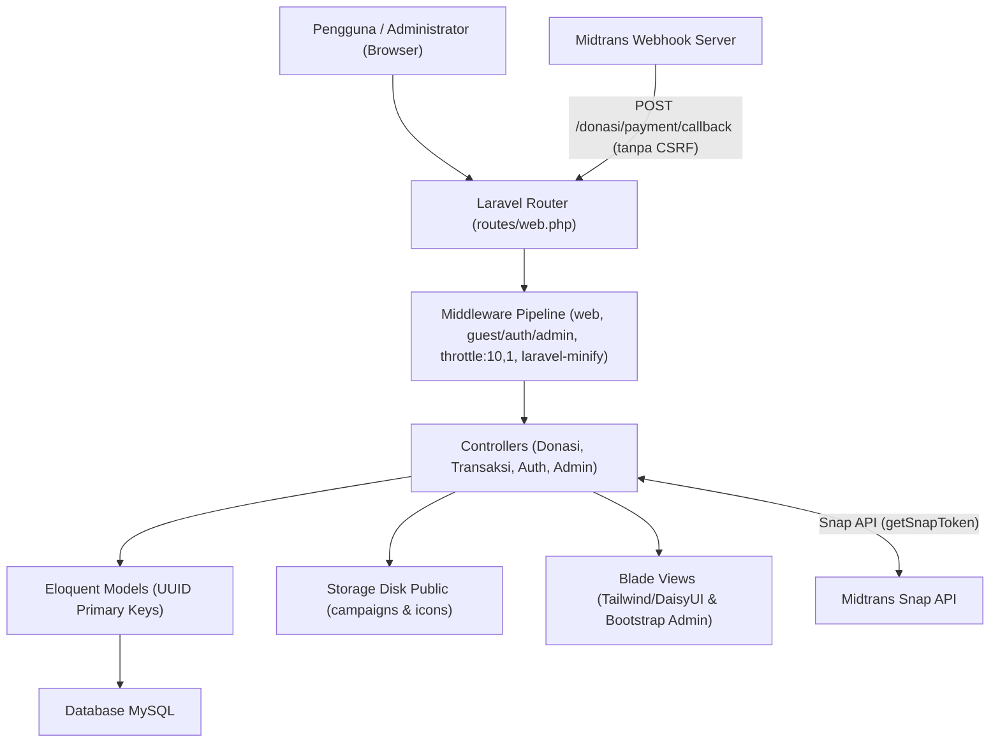
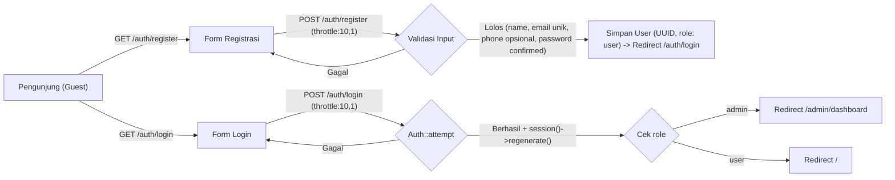
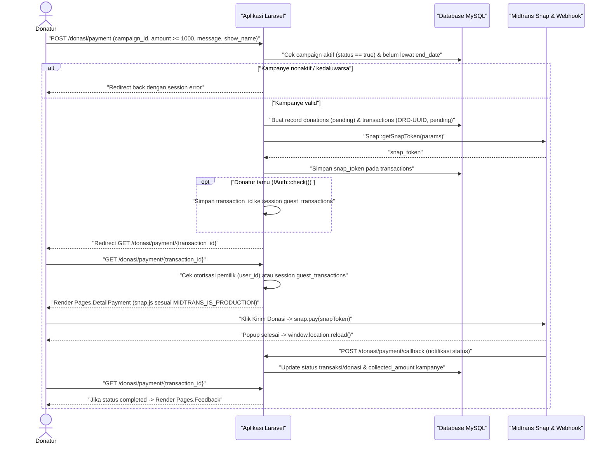
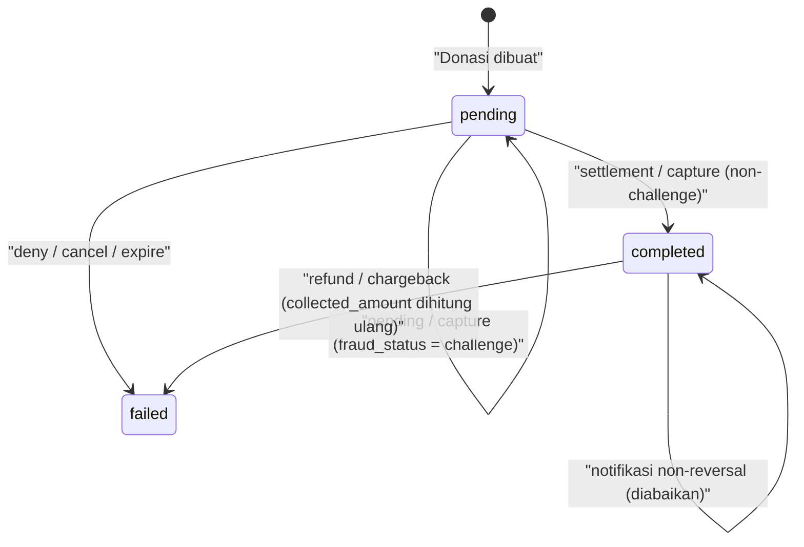
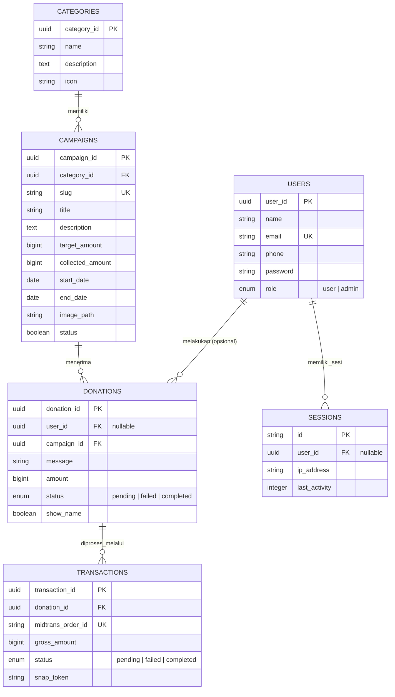

# Dokumentasi Alur Proyek — Ayo Donasi

Dokumen ini menjelaskan arsitektur, alur pengguna, alur administrator, mekanisme pembayaran Midtrans, skema data, serta alur pengembangan dan pengujian pada aplikasi **Ayo Donasi** (berbasis Laravel 11).

## Daftar Isi

- [1. Arsitektur Umum Sistem](#1-arsitektur-umum-sistem)
- [2. Peran Pengguna dan Hak Akses](#2-peran-pengguna-dan-hak-akses)
- [3. Alur Autentikasi](#3-alur-autentikasi)
- [4. Alur Eksplorasi Kampanye](#4-alur-eksplorasi-kampanye)
- [5. Alur Donasi dan Pembayaran Midtrans](#5-alur-donasi-dan-pembayaran-midtrans)
- [6. Alur Webhook Callback dan Siklus Status](#6-alur-webhook-callback-dan-siklus-status)
- [7. Alur Profil dan Riwayat Donasi](#7-alur-profil-dan-riwayat-donasi)
- [8. Alur Panel Administrator](#8-alur-panel-administrator)
- [9. Relasi Data dan Skema Database](#9-relasi-data-dan-skema-database)
- [10. Peta Rute Aplikasi](#10-peta-rute-aplikasi)
- [11. Alur Pengembangan, Pengujian, dan CI](#11-alur-pengembangan-pengujian-dan-ci)

---

## 1. Arsitektur Umum Sistem

Aplikasi menggunakan pola **MVC (Model–View–Controller)** Laravel dengan primary key berbasis **UUID** pada seluruh tabel bisnis (`users`, `categories`, `campaigns`, `donations`, `transactions`).

Catatan middleware global pada `bootstrap/app.php`:
- Middleware `admin` memetakan ke `App\Http\Middleware\isAdmin`.
- Middleware grup `web` menjalankan `MinifyHtml`, `MinifyCss`, dan `MinifyJavascript` (`fahlisaputra/laravel-minify`).
- Pengecualian CSRF hanya berlaku untuk rute webhook `donasi/payment/callback`.

---

## 2. Peran Pengguna dan Hak Akses

| Peran | Middleware | Akses Utama | Pembatasan |
| :--- | :--- | :--- | :--- |
| **Tamu (Guest)** | `web` / `guest` | Melihat beranda, katalog, kategori, detail kampanye, berdonasi, membuka halaman pembayaran miliknya, login & registrasi | Tidak dapat mengakses `/profile`, `/donasi/history`, `/logout`, atau `/admin/*`; akses `/donasi/payment/{id}` dibatasi oleh session `guest_transactions` |
| **Donatur Terdaftar (`user`)** | `auth` | Seluruh fitur publik + melihat `/profile`, `/donasi/history`, dan `/donasi/payment/{id}` miliknya sendiri | Diredirect ke halaman login jika mencoba membuka rute `/admin/*`; menerima `403` jika membuka pembayaran milik pengguna lain |
| **Administrator (`admin`)** | `admin` (`Auth::check() && Auth::user()->role === 'admin'`) | Seluruh fitur panel `/admin/*`: dashboard statistik, CRUD kategori, CRUD kampanye, dan manajemen pengguna | Akun dengan `role === 'admin'` dilindungi agar tidak dapat dihapus melalui `UsermanController@destroy` |

---

## 3. Alur Autentikasi

Rute autentikasi ditangani oleh `AuthController`. Halaman login dan register dilindungi middleware `guest`, sedangkan aksi `POST` dibatasi `throttle:10,1` (maksimal 10 permintaan per menit).

Ringkasan perilaku tiap tahap:
1. **Registrasi (`AuthController@register`)**:
   - Memvalidasi `name` (`required`, `string`, `max:255`), `email` (`required`, `email`, unik di tabel `users`), `phone` (`nullable`, `max:20`, regex angka/spasi/`+`/`-`), serta `password` (`required`, `min:8`, `confirmed`).
   - Menyimpan pengguna baru dengan `user_id` UUID otomatis (`User::boot`) dan mengarahkan ke `/auth/login`.
2. **Login (`AuthController@authenticate`)**:
   - Memvalidasi `email` dan `password`, memanggil `Auth::attempt($credentials)`, kemudian memanggil `$request->session()->regenerate()` untuk mencegah *session fixation*.
   - Mengarahkan `admin` ke `/admin/dashboard` dan `user` ke `/`.
3. **Logout (`AuthController@logout`, middleware `auth`)**:
   - Memanggil `Auth::logout()`, melakukan `invalidate()` pada session, meregenerasi CSRF token, lalu mengarahkan ke `/auth/login`.

---

## 4. Alur Eksplorasi Kampanye

Seluruh halaman eksplorasi publik ditangani oleh `DonasiController`:

1. **Beranda (`GET /` -> `DonasiController@index`)**:
   - Mengambil daftar kategori (`Category::all()`) dan seluruh kampanye menggunakan `Campaign::withTotalDonations()->get()->each->decorate()`.
2. **Katalog & Pencarian (`GET /selengkapnya` -> `DonasiController@Selengkapnya`)**:
   - Jika query parameter `q` diisi, query disaring menggunakan `where` yang dikelompokkan (`title LIKE %q%` atau `campaign_id LIKE %q%`).
   - Diurutkan dari yang terbaru (`created_at DESC`), dipaginasi 20 data per halaman (`paginate(20)->withQueryString()`), dan ditampilkan bersama kontrol paginasi di `Pages/Selengkapnya.blade.php`.
3. **Filter Kategori (`GET /category/{id}` -> `DonasiController@CategoryDonasi`)**:
   - Memuat kampanye milik kategori terkait menggunakan relasi `$category->campaigns()->withTotalDonations()->get()`. Jika kategori tidak ditemukan, kembali ke halaman sebelumnya dengan pesan error.
4. **Detail Kampanye (`GET /donasi/detail/{slug}` -> `DonasiController@DetailDonasi`)**:
   - Memuat detail kampanye berdasarkan `slug` beserta jumlah donatur berstatus `completed`.
   - Memuat daftar donatur terverifikasi secara terpaginasi (`paginate(5)`) beserta nama (atau `Anonim` jika `show_name == 0`) dan pesan doa, serta 3 rekomendasi kampanye terbaru lainnya.
   - Menyediakan modal donasi (`components/modal-payment.blade.php`) dan modal berbagi ke Facebook, Instagram, atau WhatsApp (`components/modal-share.blade.php`).

### Optimasi & Atribut Kampanye (`App\Models\Campaign`)
- **`scopeWithTotalDonations()`**: Menghitung jumlah donasi `completed` melalui `withCount` dalam satu query agar terhindar dari masalah **N+1 query**.
- **`decorate()`**: Menghitung `days_remaining` dari hari ini ke `end_date` (minimal `0`) dan persentase `progress` (`collected_amount / target_amount * 100`).
- **`image_url` accessor**: Mengembalikan `asset('storage/' . $this->image_path)` jika gambar tersedia, atau fallback ke `public/image/placeholder.svg` jika `image_path` bernilai `null`.

---

## 5. Alur Donasi dan Pembayaran Midtrans

Proses donasi menghubungkan form pada modal detail kampanye (`TransaksiController@berDonasi`), halaman instruksi pembayaran (`DonasiController@DetailPayment`), Midtrans Snap, serta endpoint callback (`TransaksiController@handleCallback`).

Aturan penting pada alur ini:
- **Validasi donasi**: `amount` minimal `1000`, `campaign_id` harus ada, dan kampanye harus berstatus aktif serta `end_date` belum melewati hari ini (`!end_date->endOfDay()->isPast()`).
- **Rate limit**: `POST /donasi/payment` dibatasi `throttle:10,1`.
- **Otorisasi `DetailPayment`**:
  - Jika donasi terhubung ke `user_id`, hanya pengguna terautentikasi dengan `user_id` yang sama yang dapat membukanya (`403` untuk selain pemilik).
  - Jika donasi tamu (`user_id === null`), `transaction_id` harus ada di dalam array session `guest_transactions` (`403` jika tidak cocok).
- **Environment Snap JS**: `DetailPayment.blade.php` otomatis memilih `https://app.midtrans.com/snap/snap.js` bila `MIDTRANS_IS_PRODUCTION=true`, dan `https://app.sandbox.midtrans.com/snap/snap.js` bila `false`.

---

## 6. Alur Webhook Callback dan Siklus Status

Endpoint `POST /donasi/payment/callback` (`TransaksiController@handleCallback`) menerima notifikasi server-to-server dari Midtrans (dikecualikan dari verifikasi CSRF pada `bootstrap/app.php`).

Urutan pemeriksaan keamanan pada `handleCallback`:
1. **Verifikasi Signature (`SHA-512`)**: Membandingkan `hash('sha512', order_id . status_code . gross_amount . server_key)` dengan `signature_key`. Jika tidak cocok, mencatat `Log::warning` dan mengembalikan `403`.
2. **Pencarian Transaksi & Donasi**: Memastikan `midtrans_order_id` dan `donation_id` ada (`404` + `Log::warning` jika tidak ditemukan).
3. **Validasi Nominal (`gross_amount`)**: Memastikan nilai integer dari `gross_amount` notifikasi sama dengan `transactions.gross_amount` (`400` + `Log::warning` jika berbeda).
4. **Penanganan Khusus**:
   - `partial_refund` / `partial_chargeback`: Dicatat dengan `Log::warning` untuk tinjauan manual tanpa mengubah status transaksi penuh.
   - `refund` / `chargeback`: Tetap diproses walau transaksi sudah `completed`; mengubah `transactions.status` dan `donations.status` menjadi `failed`, lalu menghitung ulang `campaigns.collected_amount`.
   - Status final non-reversal pada transaksi yang sudah `completed`: Diabaikan agar notifikasi terlambat tidak menimpa data final.
   - `capture` dengan `fraud_status === 'challenge'`: Status dipertahankan `pending`.
5. **Sinkronisasi Total Kampanye**: Setiap perubahan status menghitung ulang `campaigns.collected_amount` dari jumlah seluruh donasi pada kampanye tersebut yang berstatus `completed`.

---

## 7. Alur Profil dan Riwayat Donasi

Kedua fitur ini dilindungi middleware `auth`:
- **Profil Donatur (`GET /profile` -> `DonasiController@ProfileDonasi`)**: Menampilkan nama, email, nomor telepon (`phone`), total nominal donasi milik pengguna (`Donasi::where('user_id', ...)->sum('amount')`), serta tautan menuju riwayat donasi dan logout.
- **Riwayat Donasi (`GET /donasi/history` -> `DonasiController@HistoryDonasi`)**: Menampilkan daftar donasi pengguna beserta judul kampanye terkait, nominal, dan pesan.

---

## 8. Alur Panel Administrator

Seluruh rute admin berada di bawah prefix `/admin` dan middleware `admin` (`isAdmin`):

1. **Dashboard & Statistik**:
   - `GET /admin/dashboard` (`DashboardController@index`): Menampilkan total kampanye, total transaksi donatur berstatus `completed`, total kategori, dan 4 kampanye terbaru.
   - `GET /admin/statistics` (`DashboardController@campaignStats`): Mengembalikan JSON statistik total donasi, kampanye tertinggi/terendah, jumlah kampanye aktif/nonaktif, dan persentase progres tiap kampanye untuk dirender oleh **Chart.js** pada `admin/Dashboard.blade.php`.
2. **Manajemen Kategori (`/admin/categories` -> `CategoryController`)**:
   - CRUD kategori (`name`, `description`, `icon` diunggah ke disk `public` folder `icons`).
   - Saat ikon baru diunggah pada `update()` atau saat kategori dihapus melalui `destroy()`, file ikon lama dihapus otomatis dari `Storage::disk('public')`.
3. **Manajemen Kampanye (`/admin/campaigns` -> `CampaignController`)**:
   - CRUD kampanye (`category_id`, `title`, `description`, `target_amount`, `start_date`, `end_date`, `image_path` diunggah ke disk `public` folder `campaigns`, `status` `on`/`off`).
   - `slug` dibuat otomatis saat `creating` dan diperbarui ketika `title` berubah. Gambar lama dihapus saat gambar diganti atau kampanye dihapus.
   - Halaman detail (`campaigns.show`) menampilkan metrik kampanye (`withTotalDonations()->decorate()`) beserta daftar donatur terpaginasi.
4. **Manajemen Pengguna (`/admin/userman` -> `UsermanController`)**:
   - Menampilkan daftar pengguna dengan pencarian (`name` / `email`) dan paginasi 20 data per halaman (`index`).
   - Menghapus pengguna (`destroy`), dengan proteksi agar akun dengan `role === 'admin'` tidak dapat dihapus.

---

## 9. Relasi Data dan Skema Database

---

## 10. Peta Rute Aplikasi

| Method | URI | Aksi Controller | Middleware | Fungsi |
| :--- | :--- | :--- | :--- | :--- |
| `GET` | `/` | `DonasiController@index` | `web` | Halaman beranda |
| `GET` | `/selengkapnya` | `DonasiController@Selengkapnya` | `web` | Katalog & pencarian kampanye |
| `GET` | `/tentang-kami` | `DonasiController@TentangKami` | `web` | Halaman tentang kami |
| `GET` | `/category/{id}` | `DonasiController@CategoryDonasi` | `web` | Kampanye per kategori |
| `GET` | `/donasi/detail/{slug}` | `DonasiController@DetailDonasi` | `web` | Detail kampanye & daftar donatur |
| `POST` | `/donasi/payment` | `TransaksiController@berDonasi` | `web`, `throttle:10,1` | Buat donasi & Snap Token |
| `GET` | `/donasi/payment/{id}` | `DonasiController@DetailPayment` | `web` | Halaman bayar Snap / halaman terima kasih |
| `POST` | `/donasi/payment/callback` | `TransaksiController@handleCallback` | `web` (tanpa CSRF) | Webhook notifikasi Midtrans |
| `GET` | `/profile` | `DonasiController@ProfileDonasi` | `web`, `auth` | Profil & total donasi user |
| `GET` | `/donasi/history` | `DonasiController@HistoryDonasi` | `web`, `auth` | Riwayat donasi user |
| `GET` | `/auth/login` | `AuthController@showLogin` | `web`, `guest` | Form login |
| `POST` | `/auth/login` | `AuthController@authenticate` | `web`, `guest`, `throttle:10,1` | Proses login |
| `GET` | `/auth/register` | `AuthController@showRegister` | `web`, `guest` | Form registrasi |
| `POST` | `/auth/register` | `AuthController@register` | `web`, `guest`, `throttle:10,1` | Proses registrasi |
| `GET` | `/logout` | `AuthController@logout` | `web`, `auth` | Keluar dari sesi |
| `GET` | `/admin/dashboard` | `DashboardController@index` | `web`, `admin` | Dashboard ringkasan admin |
| `GET` | `/admin/statistics` | `DashboardController@campaignStats` | `web`, `admin` | Endpoint JSON grafik Chart.js |
| `RESOURCE` | `/admin/categories` | `CategoryController` | `web`, `admin` | CRUD kategori donasi |
| `RESOURCE` | `/admin/campaigns` | `CampaignController` | `web`, `admin` | CRUD kampanye donasi |
| `RESOURCE` | `/admin/userman` | `UsermanController` | `web`, `admin` | Daftar & hapus user non-admin |

---

## 11. Alur Pengembangan, Pengujian, dan CI

### Alur Setup Lokal
1. Instal dependensi: `composer install` dan `npm install`.
2. Konfigurasi `.env` dari `.env.example` (database, kredensial Midtrans, serta `ADMIN_EMAIL` / `ADMIN_PASSWORD`), lalu `php artisan key:generate`.
3. Jalankan `php artisan migrate` dan `php artisan storage:link`.
4. (Opsional) Isi data awal melalui `php artisan db:seed` (otomatis memanggil `UserSeeder`, `CategorySeeder`, lalu `CampaignSeeder` secara berurutan).
5. Jalankan server pengembangan via `composer run dev` (menjalankan `php artisan serve`, `php artisan queue:listen --tries=1`, dan `npm run dev` secara bersamaan).

### Alur Pengujian & Continuous Integration
- **Konfigurasi Tes**: `phpunit.xml` menggunakan SQLite `:memory:` (`DB_CONNECTION=sqlite`, `DB_DATABASE=:memory:`) dan `tests/Pest.php` mengaktifkan `RefreshDatabase` untuk seluruh tes `Feature`.
- **Cakupan Suite Pest**:
  - `tests/Feature/ExampleTest.php`: Memastikan halaman `/` mengembalikan HTTP 200.
  - `tests/Feature/AdminAccessTest.php`: Memastikan tamu dan pengguna biasa diredirect dari `/admin/*`, serta `/profile` dan `/donasi/history` mewajibkan login.
  - `tests/Feature/AuthTest.php`: Menguji validasi konfirmasi password, format telepon, serta pembuatan `user_id` UUID saat registrasi.
  - `tests/Feature/DonationFlowTest.php`: Menguji penolakan donasi ke kampanye nonaktif/kedaluwarsa dan di bawah Rp1.000, validasi signature dan nominal callback Midtrans, skenario `settlement`, `refund`, `chargeback`, idempotensi transaksi selesai, serta pembatasan akses `DetailPayment` untuk tamu dan user terdaftar.
- **GitHub Actions (`.github/workflows/tests.yml`)**: Setiap `push` atau `pull_request` ke branch `main` otomatis menjalankan setup PHP 8.2, `composer install`, `npm ci && npm run build`, penyalinan `.env`, dan `./vendor/bin/pest`.
