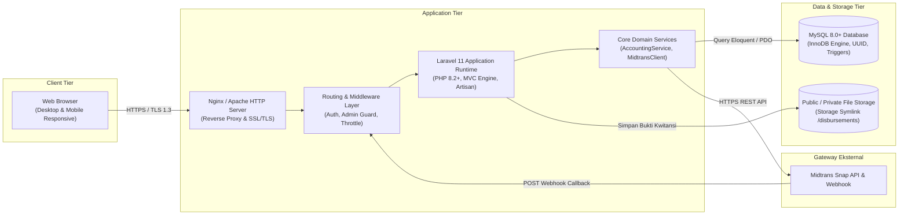
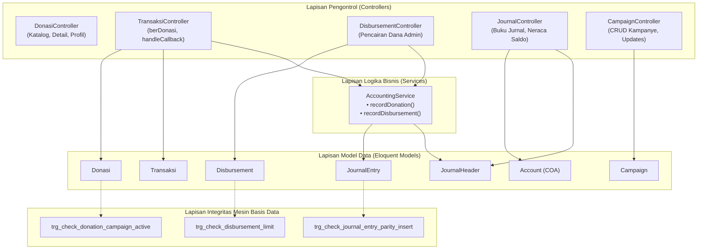
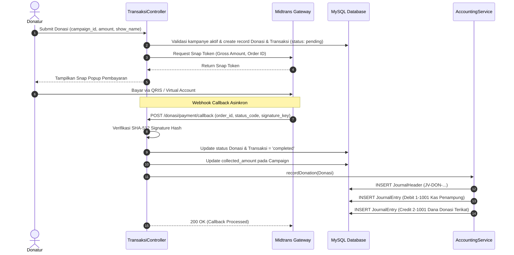
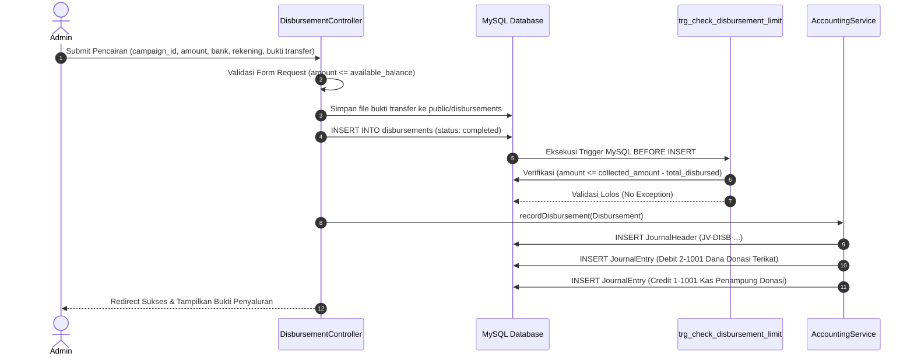
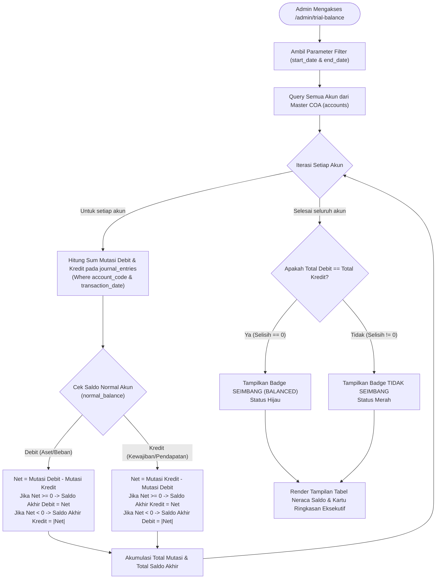

# Cetak Biru Arsitektur Sistem (System Architecture Blueprint)
## Ayo Donasi — Platform Penggalangan Dana & Akuntansi Filantropi Digital

- **Nama Dokumen:** Master Architecture & Engineering Blueprint
- **Aplikasi:** Ayo Donasi
- **Versi Sistem:** v1.1.0
- **Status:** Approved / Production-Ready
- **Penulis:** Tim Pengembang Ayo Donasi
- **Tanggal Pembaruan:** 23 November 2026

---

## 1. Ringkasan Eksekutif & Tujuan Arsitektur

**Ayo Donasi** dirancang sebagai platform *crowdfunding* (penggalangan dana publik) modern yang menggabungkan kemudahan pengalaman pengguna (*User Experience*) dengan ketatnya akuntabilitas tata kelola keuangan (*Financial Governance*). 

Dokumen ini berfungsi sebagai **Cetak Biru Tunggal (*Single Source of Truth*)** bagi pengembang, arsitek perangkat lunak, auditor keuangan, dan administrator sistem. Arsitektur Ayo Donasi dibangun di atas 4 pilar utama:
1. **Integritas Transaksi Finansial**: Mengadopsi prinsip pembukuan berpasangan (*Double-Entry Accounting Ledger*) berbasis standar PSAK 109, di mana dana sumbangan masyarakat diakui sebagai kewajiban titipan (*Restricted Funds*), bukan pendapatan sepihak.
2. **Keamanan & Validasi Ganda (*Dual-Layer Integrity*)**: Proteksi data divalidasi ganda di level aplikasi (Laravel Form Requests & Middleware) dan level mesin basis data (MySQL Database Triggers).
3. **Kepatuhan Regulasi**: Selaras dengan UU No. 9/1961 tentang Pengumpulan Uang dan Barang (PUB) serta UU No. 27/2022 tentang Pelindungan Data Pribadi (UU PDP).
4. **Skalabilitas & Kualitas Kode**: Diuji menggunakan framework **Pest PHP** dengan alur integrasi berkelanjutan (**GitHub Actions CI**).

---

## 2. Blueprint Arsitektur C4 (C4 Architecture Model)

### 2.1. Level 1: System Context Diagram

Diagram konteks menggambarkan interaksi batas sistem Ayo Donasi dengan seluruh aktor dan sistem eksternal:

```mermaid
flowchart TD
    subgraph Users ["Pengguna Eksternal"]
        DONOR["Donatur (Publik / Guest / Terdaftar)"]
        ADMIN["Administrator / Pengurus Yayasan"]
        BENEFICIARY["Penerima Manfaat / Lembaga Mitra"]
    end

    subgraph System ["Batas Sistem Ayo Donasi"]
        AYODONASI["Aplikasi Web Ayo Donasi\n(Laravel 11, Blade, Tailwind, MySQL)"]
    end

    subgraph External ["Layanan Pihak Ketiga"]
        MIDTRANS["Midtrans Payment Gateway\n(QRIS, VA, E-Wallet, Card)"]
        STORAGE["File Storage Subsystem\n(Bukti Transfer, Ikon, Foto Kampanye)"]
    end

    DONOR -- "1. Jelajahi kampanye, berdonasi & cek kabar" --> AYODONASI
    AYODONASI -- "2. Generate Snap Token pembayaran" --> MIDTRANS
    DONOR -- "3. Bayar tagihan via QRIS/VA" --> MIDTRANS
    MIDTRANS -- "4. Notifikasi Webhook (SHA-512)" --> AYODONASI
    ADMIN -- "5. Kurasi kampanye, update progres, pencairan dana & neraca" --> AYODONASI
    AYODONASI -- "6. Simpan dokumen verifikasi & kwitansi" --> STORAGE
    BENEFICIARY -- "7. Menerima dana penyaluran via transfer bank" <-- ADMIN
```

---

### 2.2. Level 2: Container Diagram

Diagram kontainer menguraikan blok teknologi yang membangun platform Ayo Donasi:



---

### 2.3. Level 3: Component Diagram

Diagram komponen memetakan modularitas internal pada lapisan backend Laravel:



---

## 3. Desain Multi-Tier & Layering Arsitektur

Platform Ayo Donasi menerapkan pola **Clean Layered MVC Architecture** yang memisahkan tanggung jawab secara tegas (*Separation of Concerns*):

| Lapisan (*Layer*) | Komponen Utama | Peran & Tanggung Jawab |
| :--- | :--- | :--- |
| **1. Presentation Layer** | Blade Templates, Tailwind CSS, DaisyUI, Bootstrap, Chart.js, Vite | Merender antarmuka publik yang ramah seluler (*mobile-first*) dan panel instrumen admin responsif. |
| **2. Security & Routing Layer** | `web.php`, `auth`, `admin`, `throttle:10,1`, CSRF Protection | Menyaring akses pengguna, proteksi rute admin, mitigasi serangan brute-force, dan validasi token sesi. |
| **3. Application / Controller Layer** | `TransaksiController`, `DisbursementController`, `JournalController` | Menerima request HTTP, memvalidasi input (*Form Request*), dan mengoordinasikan alur kerja data. |
| **4. Domain & Service Layer** | `App\Services\AccountingService` | Mengisolasi aturan bisnis akuntansi: posting otomatis voucher berpasangan ($Debit = Credit$) dan relasi polimorfik. |
| **5. Persistence Layer (ORM)** | Eloquent Models (`Campaign`, `Donasi`, `Disbursement`, `JournalHeader`) | Memetakan tabel basis data, mengelola relasi UUID, accessor, mutator, dan scope query bebas N+1. |
| **6. Database Engine Layer** | MySQL 8.0 InnoDB + 4 Triggers Validasi | Menjamin keutuhan referensial, keunikan indeks, dan mengunci aturan bisnis di level kernel SQL. |
| **7. External Integration Layer** | SDK Midtrans Snap & Webhook Notifier | Menangani pembuatan token pembayaran aman dan penerimaan callback terverifikasi SHA-512. |

---

## 4. Pipeline & Alur Kerja Transaksi Utama

### 4.1. Blueprint Pipeline Donasi Masuk & Jurnal Otomatis



---

### 4.2. Blueprint Pipeline Pencairan Dana (*Disbursement Lifecycle*)



---

### 4.3. Blueprint Mesin Laporan Neraca Saldo (*Trial Balance Engine*)



---

## 5. Arsitektur Basis Data & Skema Pembukuan

### 5.1. Bagan Akun Standar (Chart of Accounts / COA)

Platform mengadopsi struktur kode akun baku berikut:

```
[ accounts ] 1 ──────< N [ journal_entries ] >────── 1 [ journal_headers ]
                                                              │
                                                              │ (Polymorphic: source_type & source_id)
                                                              ▼
                                                  [ donations ] / [ disbursements ]
```

| Kode Akun | Nama Akun Buku Besar | Tipe (*Type*) | Saldo Normal | Peruntukan & Karakteristik |
| :---: | :--- | :---: | :---: | :--- |
| **`1-1001`** | Kas & Bank - Penampung Donasi | `asset` | Debit | Rekening bank resmi penampungan uang titipan masyarakat (*escrow*). |
| **`1-1002`** | Piutang Payment Gateway (Midtrans) | `asset` | Debit | Dana hasil donasi yang telah sukses namun belum ditarik ke rekening yayasan. |
| **`2-1001`** | Dana Donasi Terikat (Titipan Donatur) | `liability` | Kredit | Amanah dana masyarakat yang belum disalurkan kepada penerima manfaat. |
| **`4-1001`** | Pendapatan Hak Operasional Platform | `revenue` | Kredit | Biaya pengelolaan operasional resmi yayasan (maks. 10% sesuai PP PUB). |
| **`5-2001`** | Penyaluran Donasi Program | `expense` | Debit | Akumulasi dana donasi yang telah terealisasi diserahkan ke penerima manfaat. |

---

### 5.2. Matriks Penguncian Integritas Basis Data (*MySQL Triggers*)

Empat trigger validasi aktif langsung di level kernel MySQL:

```sql
-- 1. Validasi Paritas Baris Jurnal (Insert & Update)
-- Mencegah baris memiliki Debit dan Kredit sekaligus, atau keduanya nol
IF (NEW.debit > 0 AND NEW.credit > 0) OR (NEW.debit = 0 AND NEW.credit = 0) THEN
    SIGNAL SQLSTATE '45000' SET MESSAGE_TEXT = 'Gagal: Entri jurnal harus bernilai salah satu (Debit saja atau Kredit saja)!';
END IF;

-- 2. Validasi Batas Pencairan Kampanye
-- Menolak pencairan jika melebihi sisa kas kampanye terkumpul
IF NEW.amount > (v_collected - v_disbursed) THEN
    SIGNAL SQLSTATE '45000' SET MESSAGE_TEXT = 'Gagal: Nominal pencairan melebihi sisa dana kampanye yang tersedia!';
END IF;

-- 3. Validasi Keaktifan Kampanye Donasi
-- Menolak donasi pada kampanye berstatus nonaktif atau melewati batas waktu
IF v_status = 0 OR v_end_date < CURDATE() THEN
    SIGNAL SQLSTATE '45000' SET MESSAGE_TEXT = 'Gagal: Kampanye donasi sedang tidak aktif atau batas waktu telah berakhir!';
END IF;
```

---

## 6. Blueprint Keamanan, Tata Kelola & Kepatuhan

### 6.1. Proteksi Pembayaran & Webhook Tampering
1. **Validasi Signature SHA-512**:
   $$\text{Hash} = \text{SHA512}(\text{order\_id} + \text{status\_code} + \text{gross\_amount} + \text{ServerKey})$$
   Jika hash notifikasi webhook tidak cocok dengan perhitungan internal server, sistem langsung menolak dengan respons HTTP `403 Forbidden`.
2. **Idempotency Protection**:
   Jika Midtrans mengirimkan notifikasi callback berulang untuk transaksi yang sudah `completed`, sistem tidak mengeksekusi penambahan saldo ganda maupun pencatatan jurnal ganda.

### 6.2. Proteksi Akses & Kontrol Peran (*Role-Based Access Control / RBAC*)
- Middleware `admin` mengamankan seluruh rute krusial (`/admin/*`).
- Akun berstatus `role = 'admin'` memiliki proteksi khusus pada model dan pengontrol agar **tidak dapat dihapus secara tidak sengaja (*undeletable admin safeguard*)**.

### 6.3. Kepatuhan Pelindungan Data Pribadi (UU PDP No. 27/2022)
- **Opsi Donasi Anonim (*Show Name = false*)**: Nama donatur disembunyikan sebagai *"Hamba Allah"* di antarmuka publik.
- **Kerahasiaan Kredensial**: Password terenkripsi searah menggunakan algoritma `bcrypt` dengan cost factor terstandar.
- **Minimisasi Data**: Donatur tamu (*guest donor*) dapat menyumbang tanpa harus membuat akun profil lengkap.

---

## 7. Blueprint Infrastruktur, Topologi & Deployment

### 7.1. Spesifikasi Lingkungan Produksi (*Production Stack*)
- **Sistem Operasi**: Linux Ubuntu 22.04 LTS / 24.04 LTS (atau Windows Server IIS/Apache).
- **Web Server**: Nginx `1.24+` dengan reverse proxy PHP-FPM dan sertifikat SSL/TLS Let's Encrypt (A+ Rating).
- **PHP Runtime**: PHP `^8.2` (ekstensi wajib: `pdo_mysql`, `curl`, `mbstring`, `openssl`, `gd`, `bcmath`).
- **Database Server**: MySQL `8.0+` atau MariaDB `10.5+` dengan engine default `InnoDB`.

### 7.2. Skema Backup & Pemulihan Bencana (*Disaster Recovery*)
1. **Cold Backup**: File skrip SQL DDL murni tersedia di [database/schema.sql](file:///d:/Project/donasi/database/schema.sql) untuk re-deployment cepat tanpa ketergantungan runtime Composer.
2. **Automated Database Backup**: Eksekusi *daily dump cron*:
   ```bash
   mysqldump -u donasi_user -p donasi_db --single-transaction --quick > /backups/donasi_$(date +%Y%m%d).sql
   ```
3. **Storage Persistence**: Direktori `storage/app/public` wajib disinkronkan ke cloud storage (Google Cloud Storage / AWS S3) secara periodik.

### 7.3. Pipeline Pengujian Berkelanjutan (CI/CD Quality Assurance)
Setiap commit dan *pull request* pada branch `main` divalidasi secara otomatis melalui **GitHub Actions Workflow** (`.github/workflows/tests.yml`):
- Pengecekan sintaks PHP.
- Migrasi skema database SQLite *in-memory*.
- Eksekusi rangkaian pengujian fungsional **Pest PHP** (`tests/Feature/*`).

---

## 8. Matriks Keterhubungan Dokumen Spesifikasi

Cetak biru ini terhubung secara terpadu dengan dokumen spesifikasi teknis lainnya di direktori `docs/`:

| Dokumen Terkait | Path Berkas | Fokus Bahasan |
| :--- | :--- | :--- |
| **Roadmap Modular Monolith** | [ROADMAP_MODULAR_MONOLITH.md](file:///d:/Project/donasi/docs/ROADMAP_MODULAR_MONOLITH.md) | Panduan evolusi domain vertikal, DDD bounded contexts, dan transisi modular enterprise. |
| **Alur & Siklus Proyek** | [ALUR_PROYEK.md](file:///d:/Project/donasi/docs/ALUR_PROYEK.md) | Tahapan pengembangan proyek dari fase inisiasi hingga rilis. |
| **Diagram Basis Data** | [DIAGRAM_DATABASE.md](file:///d:/Project/donasi/docs/DIAGRAM_DATABASE.md) | ERD Mermaid lengkap dan kamus data 17 tabel. |
| **Pedoman Jurnal Keuangan** | [PEDOMAN_JURNAL_KEUANGAN_DONASI.md](file:///d:/Project/donasi/docs/PEDOMAN_JURNAL_KEUANGAN_DONASI.md) | Standar PSAK 109 dan matriks debit/kredit filantropi. |
| **Skenario Use Case** | [USE_CASE_DIAGRAM_DAN_SKENARIO.md](file:///d:/Project/donasi/docs/USE_CASE_DIAGRAM_DAN_SKENARIO.md) | Aktor, use case diagram UML, dan skenario interaksi sistem. |
| **Desain Wireframe UI/UX** | [WIREFRAME_DAN_UI_UX_DESIGN.md](file:///d:/Project/donasi/docs/WIREFRAME_DAN_UI_UX_DESIGN.md) | Tata letak antarmuka, hierarki tipografi, dan flow desain. |
| **SOP Anti-Fraud & Verifikasi** | [SOP_VERIFIKASI_DAN_MITIGASI_FRAUD.md](file:///d:/Project/donasi/docs/SOP_VERIFIKASI_DAN_MITIGASI_FRAUD.md) | Prosedur KYC yayasan, kurasi kampanye, dan audit pencairan. |
| **Kepatuhan Badan Hukum** | [SARAN_RELASI_BADAN_HUKUM.md](file:///d:/Project/donasi/docs/SARAN_RELASI_BADAN_HUKUM.md) | Rekomendasi izin PUB Kemensos dan struktur hukum yayasan. |
| **Syarat & Kebijakan Privasi** | [SYARAT_KETENTUAN_DAN_PRIVASI.md](file:///d:/Project/donasi/docs/SYARAT_KETENTUAN_DAN_PRIVASI.md) | Klausul legalitas platform, disclaimer, dan privasi UU PDP. |
