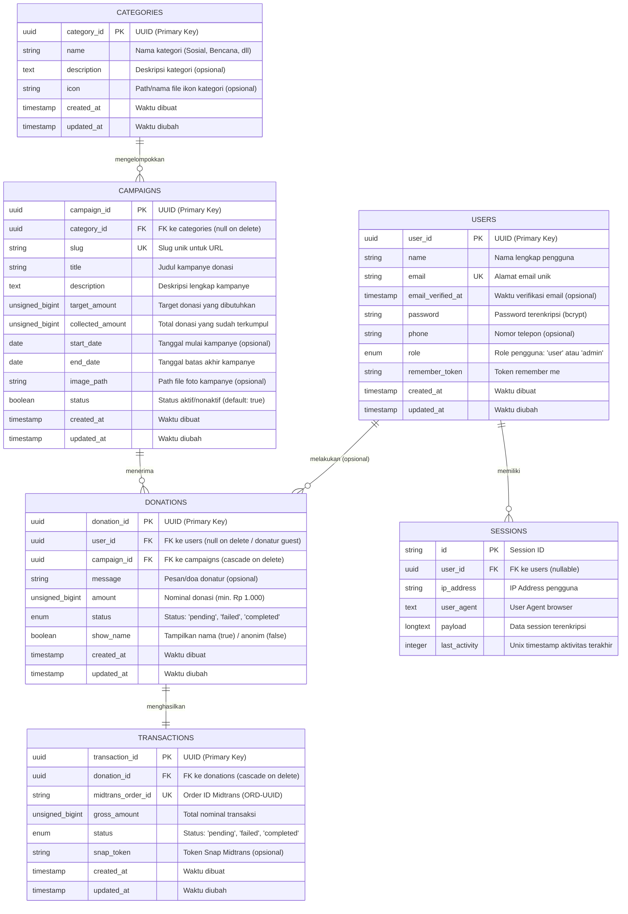

# Bagan Diagram Database — Ayo Donasi

Dokumen ini berisi bagan Entity Relationship Diagram (ERD) dan rincian struktur tabel database pada aplikasi **Ayo Donasi** berbasis Laravel 11 dan MySQL.

---

## 1. Entity Relationship Diagram (ERD)

Diagram berikut merepresentasikan seluruh entitas utama dan relasinya di dalam sistem database:

---

## 2. Rincian Kamus Data (Data Dictionary)

### 2.1. Tabel `users`
Menyimpan data akun pengguna dan administrator.
- **Primary Key:** `user_id` (UUID)

| Kolom | Tipe Data | Nullable | Keterangan |
| :--- | :--- | :---: | :--- |
| `user_id` | `CHAR(36)` / UUID | Tidak | ID unik pengguna |
| `name` | `VARCHAR(255)` | Tidak | Nama pengguna |
| `email` | `VARCHAR(255)` | Tidak | Alamat email (Unique) |
| `email_verified_at` | `TIMESTAMP` | Ya | Waktu verifikasi email |
| `password` | `VARCHAR(255)` | Tidak | Password terenkripsi (Hash::make) |
| `phone` | `VARCHAR(255)` | Ya | Nomor telepon |
| `role` | `ENUM('user', 'admin')` | Tidak | Role pengguna (Default: `'user'`) |
| `remember_token` | `VARCHAR(100)` | Ya | Token "Ingat saya" |
| `created_at` | `TIMESTAMP` | Ya | Waktu record dibuat |
| `updated_at` | `TIMESTAMP` | Ya | Waktu record terakhir diperbarui |

---

### 2.2. Tabel `categories`
Menyimpan kategori kampanye (contoh: Pendidikan, Bencana Alam, Sosial, Medis).
- **Primary Key:** `category_id` (UUID)

| Kolom | Tipe Data | Nullable | Keterangan |
| :--- | :--- | :---: | :--- |
| `category_id` | `CHAR(36)` / UUID | Tidak | ID unik kategori |
| `name` | `VARCHAR(255)` | Tidak | Nama kategori |
| `description` | `TEXT` | Ya | Keterangan kategori |
| `icon` | `VARCHAR(255)` | Ya | Path file ikon pada storage |
| `created_at` | `TIMESTAMP` | Ya | Waktu record dibuat |
| `updated_at` | `TIMESTAMP` | Ya | Waktu record terakhir diperbarui |

---

### 2.3. Tabel `campaigns`
Menyimpan data kampanye penggalangan dana.
- **Primary Key:** `campaign_id` (UUID)
- **Foreign Key:** `category_id` $\rightarrow$ `categories.category_id` (`ON DELETE SET NULL`)

| Kolom | Tipe Data | Nullable | Keterangan |
| :--- | :--- | :---: | :--- |
| `campaign_id` | `CHAR(36)` / UUID | Tidak | ID unik kampanye |
| `category_id` | `CHAR(36)` / UUID | Ya | Relasi ke kategori donasi |
| `slug` | `VARCHAR(255)` | Tidak | URL slug (Unique) |
| `title` | `VARCHAR(255)` | Tidak | Judul kampanye |
| `description` | `TEXT` | Tidak | Deskripsi lengkap |
| `target_amount` | `BIGINT UNSIGNED` | Tidak | Target donasi |
| `collected_amount` | `BIGINT UNSIGNED` | Tidak | Dana terkumpul (Default: `0`) |
| `start_date` | `DATE` | Ya | Tanggal mulai kampanye |
| `end_date` | `DATE` | Tidak | Tanggal berakhir kampanye |
| `image_path` | `VARCHAR(255)` | Ya | Path file gambar kampanye |
| `status` | `BOOLEAN` | Tidak | Status kampanye (`true`=aktif, `false`=nonaktif) |
| `created_at` | `TIMESTAMP` | Ya | Waktu record dibuat |
| `updated_at` | `TIMESTAMP` | Ya | Waktu record terakhir diperbarui |

---

### 2.4. Tabel `donations`
Menyimpan pencatatan donasi yang dilakukan pengguna (baik guest maupun user login).
- **Primary Key:** `donation_id` (UUID)
- **Foreign Keys:**
  - `user_id` $\rightarrow$ `users.user_id` (`ON DELETE SET NULL`)
  - `campaign_id` $\rightarrow$ `campaigns.campaign_id` (`ON DELETE CASCADE`)

| Kolom | Tipe Data | Nullable | Keterangan |
| :--- | :--- | :---: | :--- |
| `donation_id` | `CHAR(36)` / UUID | Tidak | ID unik donasi |
| `user_id` | `CHAR(36)` / UUID | Ya | Relasi user (null jika donatur guest) |
| `campaign_id` | `CHAR(36)` / UUID | Tidak | Relasi kampanye tujuan |
| `message` | `VARCHAR(255)` | Ya | Pesan / doa dari donatur |
| `amount` | `BIGINT UNSIGNED` | Tidak | Nominal donasi |
| `status` | `ENUM('pending', 'failed', 'completed')` | Tidak | Status donasi (Default: `'pending'`) |
| `show_name` | `BOOLEAN` | Tidak | Tampilkan nama (`true`) / Anonim (`false`) |
| `created_at` | `TIMESTAMP` | Ya | Waktu record dibuat |
| `updated_at` | `TIMESTAMP` | Ya | Waktu record terakhir diperbarui |

---

### 2.5. Tabel `transactions`
Menyimpan data transaksi gateway pembayaran (Midtrans Snap).
- **Primary Key:** `transaction_id` (UUID)
- **Foreign Key:** `donation_id` $\rightarrow$ `donations.donation_id` (`ON DELETE CASCADE`)

| Kolom | Tipe Data | Nullable | Keterangan |
| :--- | :--- | :---: | :--- |
| `transaction_id` | `CHAR(36)` / UUID | Tidak | ID unik transaksi internal |
| `donation_id` | `CHAR(36)` / UUID | Tidak | Relasi ke donasi |
| `midtrans_order_id`| `VARCHAR(255)` | Tidak | Order ID unik Midtrans (`ORD-{UUID}`) |
| `gross_amount` | `BIGINT UNSIGNED` | Tidak | Nominal bruto transaksi |
| `status` | `ENUM('pending', 'failed', 'completed')` | Tidak | Status transaksi (Default: `'pending'`) |
| `snap_token` | `VARCHAR(255)` | Ya | Token Snap untuk memunculkan popup pembayaran |
| `created_at` | `TIMESTAMP` | Ya | Waktu record dibuat |
| `updated_at` | `TIMESTAMP` | Ya | Waktu record terakhir diperbarui |

---

## 3. Tabel Pendukung Framework (Bawaan Laravel)

1. **`sessions`**: Menyimpan sesi pengguna saat menggunakan database driver session (`SESSION_DRIVER=database`).
2. **`password_reset_tokens`**: Menyimpan token reset kata sandi pengguna.
3. **`cache` & `cache_locks`**: Menyimpan data cache sistem saat menggunakan database cache driver.
4. **`jobs`, `job_batches`, `failed_jobs`**: Mengelola antrean asynchronous (queue worker) untuk pengiriman email atau proses background.
