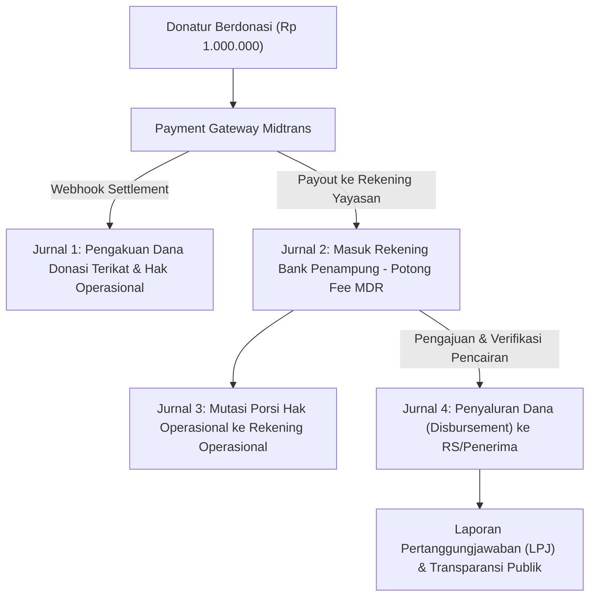

# Pedoman Pencatatan Jurnal Keuangan & Akuntansi Donasi — Ayo Donasi

Pedoman ini menyajikan standar pencatatan akuntansi dan jurnal keuangan pada platform **Ayo Donasi**, yang diselaraskan dengan prinsip dasar **PSAK 109 (Akuntansi Zakat, Infis, dan Sedekah)** serta regulasi **Pengumpulan Uang dan Barang (PUB)** di Indonesia.

---

## 1. Prinsip Dasar Akuntansi Donasi

Dalam platform penggalangan dana (*crowdfunding*):
1. **Titipan / Amanah (Fiduciary Funds)**: Dana donasi yang masuk dari masyarakat **bukan merupakan pendapatan milik platform**, melainkan dana titipan (*Restricted Funds / Dana Terikat*) yang wajib disalurkan 100% kepada penerima manfaat, dikurangi hak operasional resmi jika disepakati.
2. **Pencatatan Berbasis Kas (Cash Basis) & Akrual Termodifikasi**: Transaksi diakui saat dana berhasil terverifikasi masuk melalui payment gateway (`completed`), bukan saat donatur baru membuat order (`pending`).
3. **Pemisahan Kas**:
   - **Kas Donasi (Escrow / Bank Penampung)**: Khusus uang sumbangan para donatur.
   - **Kas Operasional Platform**: Khusus biaya administrasi/ujrah pengelolaan.

---

## 2. Bagan Akun Standar (Chart of Accounts / COA)

Berikut akun-akun utama yang digunakan dalam pembukuan keuangan platform donasi:

| Kode Akun | Nama Akun | Klasifikasi | Keterangan |
| :---: | :--- | :--- | :--- |
| **1-1001** | Kas & Bank - Penampung Donasi | Aset Lancar | Rekening bank penampungan dana masyarakat |
| **1-1002** | Piutang Payment Gateway (Midtrans) | Aset Lancar | Dana donasi settlement yang belum dicairkan ke bank |
| **1-1003** | Kas & Bank - Operasional | Aset Lancar | Rekening operasional yayasan/pengelola |
| **2-1001** | Dana Donasi Terikat (Titipan Donasi) | Kewajiban / Liabilitas | Saldo dana kampanye yang belum disalurkan |
| **4-1001** | Pendapatan Hak Operasional Platform | Pendapatan | Biaya pengelolaan resmi (maksimal 10% sesuai regulasi) |
| **5-1001** | Biaya Gateway & Transaksi Payment | Beban | Biaya MDR per transaksi (kartu kredit/QRIS/VA) |
| **5-2001** | Penyaluran Dana Donasi | Pengeluaran Penyaluran | Dana yang keluar/ditransfer ke penerima manfaat |

---

## 3. Ilustrasi & Matriks Jurnal Transaksi

Berikut contoh alur simulasi transaksi dari donasi masuk hingga pencairan dana:

### Skenario Kasus:
- Kampanye: *"Bantuan Medis Ananda Budi"*
- Donatur mendonasikan uang: **Rp 1.000.000** via Midtrans (QRIS).
- Biaya MDR Midtrans (QRIS 0.7%): **Rp 7.000**.
- Platform mengambil hak kelola operasional (5%): **Rp 50.000**.
- Sisa dana bersih yang dialokasikan untuk kampanye: **Rp 950.000**.
- Penarikan dana disalurkan ke RS: **Rp 950.000**.

---

### 3.1. Jurnal Saat Donasi Diterima & Terverifikasi (Midtrans Settlement)

Saat webhook Midtrans callback mengirim status `settlement/capture`:

```text
(Debit)  1-1002 Piutang Payment Gateway (Midtrans)   Rp 1.000.000
    (Kredit) 2-1001 Dana Donasi Terikat (Kampanye Budi)    Rp 950.000
    (Kredit) 4-1001 Pendapatan Hak Operasional             Rp   50.000
```
*(Keterangan: Mencatat penerimaan donasi, pemisahan dana titipan kampanye, dan hak operasional).*

---

### 3.2. Jurnal Saat Midtrans Mencairkan Dana ke Rekening Bank Yayasan

Saat dana dari Midtrans ditransfer ke rekening bank resmi yayasan (dikurangi biaya MDR Rp 7.000):

```text
(Debit)  1-1001 Kas & Bank - Penampung Donasi        Rp   993.000
(Debit)  5-1001 Biaya Gateway & Payment              Rp     7.000
    (Kredit) 1-1002 Piutang Payment Gateway (Midtrans)     Rp 1.000.000
```
*(Keterangan: Penerimaan mutasi transfer dari Midtrans ke rekening giro bank yayasan setelah dipotong biaya transaksi).*

---

### 3.3. Jurnal Saat Pemindahan Hak Kelola Operasional ke Kas Operasional

Pemisahan hak operasional 5% dari rekening donasi ke rekening operasional:

```text
(Debit)  1-1003 Kas & Bank - Operasional             Rp    50.000
    (Kredit) 1-1001 Kas & Bank - Penampung Donasi          Rp    50.000
```
*(Keterangan: Memindahkan porsi operasional resmi yayasan ke rekening tersendiri).*

---

### 3.4. Jurnal Saat Pencairan Dana (Disbursement) ke Penerima Manfaat

Saat admin mencatat penyaluran dana sebesar Rp 950.000 dan mentransfer ke rekening Rumah Sakit:

```text
(Debit)  2-1001 Dana Donasi Terikat (Kampanye Budi)  Rp   950.000
    (Kredit) 1-1001 Kas & Bank - Penampung Donasi          Rp   950.000
```
*(Keterangan: Liabilitas/kewajiban amanah donasi gugur karena dana telah berhasil ditransfer kepada penerima manfaat).*

---

## 4. Diagram Alur Siklus Pembukuan Akuntansi



---

## 5. Hubungan dengan Skema Database `donasi`

Untuk menghubungkan pedoman akuntansi ini dengan tabel-tabel di aplikasi:

| Konsep Akuntansi | Tabel & Kolom di Sistem |
| :--- | :--- |
| **Dana Donasi Masuk** | Tabel `donations.amount` & `transactions.gross_amount` |
| **Status Settlement/Valid** | `transactions.status = 'completed'` |
| **Rekap Dana Masuk per Kampanye** | `campaigns.collected_amount` |
| **Penyaluran / Pengeluaran Kas** | Tabel `disbursements.amount` (status `'completed'`) |
| **Total Akumulasi Penyaluran** | Accessor Model `Campaign::getTotalDisbursedAttribute()` |
| **Saldo Bersih Belum Disalurkan**| Accessor Model `Campaign::getAvailableBalanceAttribute()` |
| **Bukti Pengeluaran Kas (Voucher)**| Kolom `disbursements.receipt_path` (Foto/Kuitansi Bank) |

---

## 6. Format Laporan Rekonsiliasi Finansial (Laporan Penyaluran)

Setiap akhir periode atau saat kampanye ditutup, sistem dapat menghasilkan ringkasan pembukuan per kampanye dengan format:

```text
==================================================================
           LAPORAN PERTANGGUNGJAWABAN FINANSIAL KAMPANYE
==================================================================
Nama Kampanye       : Bantuan Medis Ananda Budi
Periode             : 01 Nov 2026 - 20 Nov 2026
Penanggung Jawab    : Admin / PIC Yayasan

[A] PENERIMAAN DANA DONASI
    Total Donasi Terkumpul (Completed)      : Rp  1.000.000
    Hak Kelola Operasional (5%)             : (Rp    50.000)
    -------------------------------------------------------
    Total Dana Bersih Siap Salur            : Rp    950.000

[B] PENGELUARAN / PENCAIRAN DANA
    1. 10/11/2026 - Tahap 1 (RS Sardjito)   : Rp    500.000  [Bukti: resi_01.jpg]
    2. 18/11/2026 - Tahap 2 (Obat Farmasi)  : Rp    450.000  [Bukti: resi_02.jpg]
    -------------------------------------------------------
    Total Dana Tersalurkan                  : Rp    950.000

[C] SALDO SISA KAMPANYE                     : Rp          0 (Selesai)
==================================================================
```
