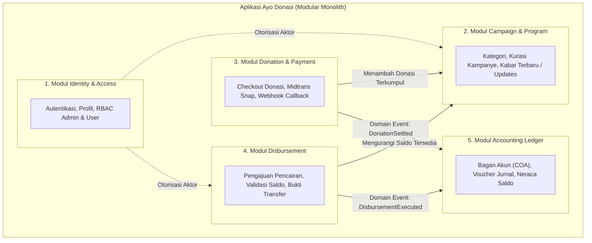
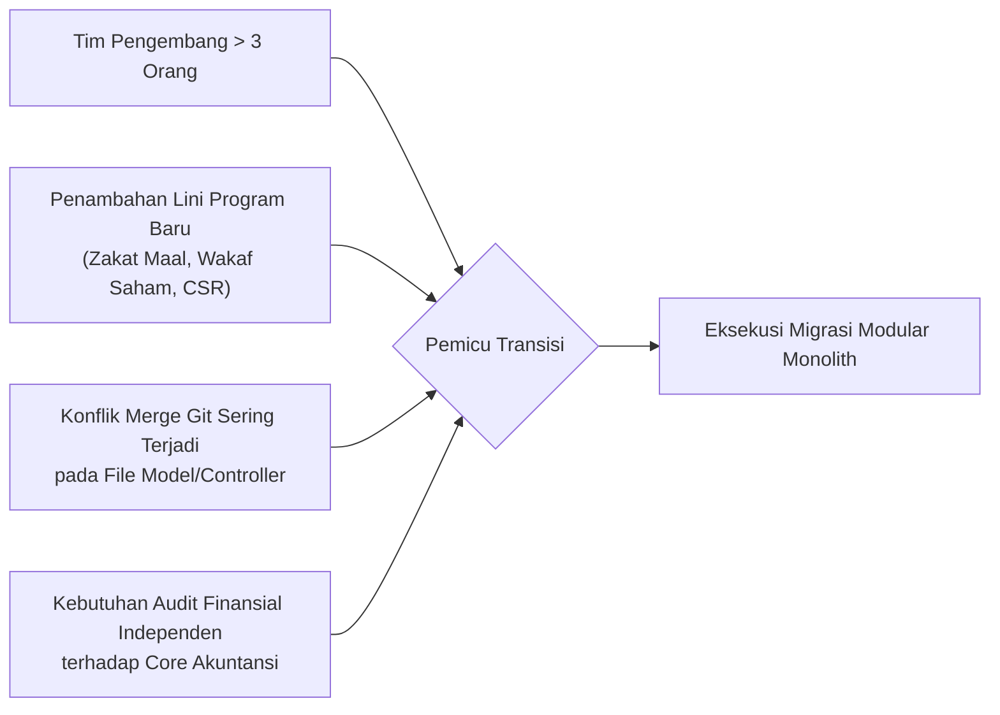

# Cetak Biru & Roadmap Arsitektur Modular Monolith
## Ayo Donasi — Panduan Transisi Menuju Skalabilitas Enterprise

- **Nama Dokumen:** Roadmap & Desain Arsitektur Modular Monolith
- **Aplikasi:** Ayo Donasi
- **Status:** Architecture Evolution Blueprint / Planned Roadmap
- **Target Implementasi:** Fase Pertumbuhan Lanjutan (Scale-up Phase)
- **Tanggal Penyusunan:** 23 November 2026

---

## 1. Latar Belakang & Rasional Arsitektur

Saat ini platform **Ayo Donasi** beroperasi secara stabil di atas arsitektur **Layered MVC Monolith** (Model-View-Controller) bawaan Laravel 11. Arsitektur ini terbukti sangat cepat dikembangkan, mudah diuji, dan memiliki *overhead* pemeliharaan yang rendah untuk skala pengembang tunggal hingga tim kecil.

Namun, seiring pertumbuhan platform filantropi menuju skala institusional (penambahan pengembang, variasi program sosial, integrasi multi-rekening bank, dan audit kepatuhan keuangan berskala besar), pengelompokan kode berbasis lapisan horizontal (*horizontal layering*) berpotensi menimbulkan kendala:
1. **Risiko Keterikatan Tinggi (*High Coupling*)**: Logika transaksi, pembayaran, dan pencatatan akuntansi rentan saling bertumpuk di controller/model.
2. **Konflik Kode Tim (*Merge Conflicts*)**: Banyak pengembang mengerjakan file controller atau migration yang sama secara simultan.
3. **Kesulitan Ekstraksi Layanan**: Apabila salah satu modul (misal: *Accounting Engine*) ingin dipisahkan ke server terpisah di masa depan, pemisahannya akan memakan biaya refactoring yang tinggi jika batas domain (*bounded context*) tidak jelas sejak awal.

**Modular Monolith** hadir sebagai solusi jalan tengah terbaik: **tetap dideploy sebagai 1 unit aplikasi tunggal (1 repositori, 1 proses runtime, 1 database terpadu, tanpa latency jaringan microservices), namun kode diorganisasi secara vertikal berdasarkan modul domain yang independen**.

---

## 2. Pemetaan Batas Domain (Domain Bounded Contexts)

Berdasarkan analisis alur bisnis Ayo Donasi, sistem dipecah menjadi **5 Modul Inti Vertikal**:



### Rincian Tanggung Jawab Modul:

| Modul | Nama Bounded Context | Tanggung Jawab Utama | Model / Entitas Utama |
| :--- | :--- | :--- | :--- |
| **1. Identity** | `App\Modules\Identity` | Autentikasi sesi, registrasi, profil pengguna, dan otorisasi hak akses peran (*Role-Based Access Control*). | `User`, `Role` |
| **2. Campaign** | `App\Modules\Campaign` | Manajemen kategori, pembuatan kampanye donasi, target dana, masa aktif, dan publikasi kabar progres (*updates*). | `Category`, `Campaign`, `CampaignUpdate` |
| **3. Donation** | `App\Modules\Donation` | Alur berdonasi (guest & member), enkripsi Snap Token Midtrans, penanganan webhook callback, dan idempotency transaksi. | `Donasi`, `Transaksi` |
| **4. Disbursement**| `App\Modules\Disbursement` | Pengajuan penyaluran dana ke penerima manfaat, verifikasi batas saldo, upload bukti resi transfer, dan persetujuan admin. | `Disbursement` |
| **5. Accounting** | `App\Modules\Accounting` | Master Chart of Accounts (COA), pencatatan jurnal umum berpasangan polimorfik, penegakan audit trail, dan kalkulasi Neraca Saldo (*Trial Balance*). | `Account`, `JournalHeader`, `JournalEntry` |

---

## 3. Desain Struktur Direktori Modul Vertikal

Setiap modul memiliki struktur mandiri yang membungkus *Controllers*, *Models*, *Services*, *Routes*, dan *Views* miliknya sendiri:

```text
app/
├── Modules/
│   ├── Shared/                               # Komponen lintas modul (Traits, Helper, Base Classes)
│   │   ├── Contracts/
│   │   └── DTOs/
│   │
│   ├── Identity/                              # Modul Autentikasi & Akun
│   │   ├── Controllers/AuthController.php
│   │   ├── Models/User.php
│   │   └── Routes/web.php
│   │
│   ├── Campaign/                              # Modul Kampanye & Program
│   │   ├── Controllers/CampaignController.php
│   │   ├── Controllers/CampaignUpdateController.php
│   │   ├── Models/Campaign.php
│   │   ├── Models/CampaignUpdate.php
│   │   └── Views/
│   │
│   ├── Donation/                              # Modul Donasi & Payment Gateway
│   │   ├── Controllers/TransaksiController.php
│   │   ├── Models/Donasi.php
│   │   ├── Models/Transaksi.php
│   │   ├── Services/MidtransGatewayService.php
│   │   └── Events/DonationSettledEvent.php
│   │
│   ├── Disbursement/                          # Modul Penyaluran Dana
│   │   ├── Controllers/DisbursementController.php
│   │   ├── Models/Disbursement.php
│   │   ├── Rules/AvailableBalanceRule.php
│   │   └── Events/DisbursementCompletedEvent.php
│   │
│   └── Accounting/                            # Modul Buku Besar & Laporan Finansial
│       ├── Controllers/JournalController.php
│       ├── Models/Account.php
│       ├── Models/JournalHeader.php
│       ├── Models/JournalEntry.php
│       ├── Services/AccountingService.php
│       ├── Listeners/RecordDonationJournalListener.php
│       ├── Listeners/RecordDisbursementJournalListener.php
│       └── Views/
│           ├── journal/index.blade.php
│           └── journal/trial_balance.blade.php
```

---

## 4. Mekanisme Komunikasi Antar-Modul (*Inter-Module Communication*)

Untuk menghindari keterikatan ketat (*tight coupling*), komunikasi antar-modul diatur dengan aturan:

### 4.1. Pola Berbasis Peristiwa Domain (*Event-Driven Architecture*)
Modul tidak memanggil langsung logika internal modul lain secara langsung jika tidak diperlukan. Sebagai contoh:
- Saat notifikasi pembayaran Midtrans sukses, modul `Donation` memicu domain event:
  ```php
  event(new DonationSettledEvent($donation));
  ```
- Modul `Accounting` mendengarkan (*listen*) event tersebut via `RecordDonationJournalListener` untuk membukukan voucher debit/kredit tanpa modul `Donation` perlu mengetahui detail akun COA `1-1001` atau `2-1001`.

### 4.2. Pola Kontrak Layanan (*Service Contracts / Interfaces*)
Jika suatu modul membutuhkan pembacaan data dari modul lain (misalnya modul `Disbursement` membutuhkan pengecekan sisa saldo dari modul `Campaign`), komunikasi dilakukan melalui antarmuka kontrak publik:
```php
namespace App\Modules\Campaign\Contracts;

interface CampaignBalanceInterface {
    public function getAvailableBalance(string $campaignId): int;
}
```

---

## 5. Indikator & Pemicu Migrasi (*When to Migrate?*)

Transisi arsitektur fisik ke Modular Monolith **wajib dimulai** apabila salah satu indikator berikut terpenuhi:



---

## 6. Tahapan Eksekusi Migrasi Bertahap (Phased Roadmap)

Migrasi tidak dilakukan secara mendadak (*big-bang rewrite*), melainkan bertahap 4 fase:

```
[ Fase 1: Modularitas Logis ] ──> [ Fase 2: Ekstraksi Modul Accounting ] ──> [ Fase 3: Event-Driven Decoupling ] ──> [ Fase 4: Full Modular Monolith ]
       (STATUS SAAT INI)
```

1. **Fase 1 — Modularitas Logis (Status Saat Ini - SELESAI)**:
   - Pemisahan logika bisnis inti ke dalam *Domain Services* (`AccountingService`).
   - Penegakan integritas data ganda via Database Triggers.
2. **Fase 2 — Ekstraksi Modul Accounting**:
   - Memindahkan model `Account`, `JournalHeader`, `JournalEntry` dan `JournalController` ke namespace `App\Modules\Accounting`.
   - Menguji isolasi laporan Neraca Saldo.
3. **Fase 3 — Event-Driven Decoupling**:
   - Mengganti pemanggilan statis `AccountingService::recordDonation` menjadi `Event & Listener` berbasis antrean Laravel.
4. **Fase 4 — Full Modular Monolith**:
   - Pemisahan modul `Campaign`, `Donation`, `Disbursement`, dan `Identity`.
   - Pendaftaran modul menggunakan `ModuleServiceProvider` otomatis.

---

## 7. Kesimpulan

Arsitektur **Modular Monolith** adalah target evolusi yang sangat ideal bagi **Ayo Donasi**. Pendekatan ini menjaga performa tinggi dan kesederhanaan infrastruktur server tunggal, sekaligus memberikan disiplin batas domain bertaraf *enterprise* yang siap bertransformasi menjadi *microservices* kapan pun diperlukan di masa depan.
