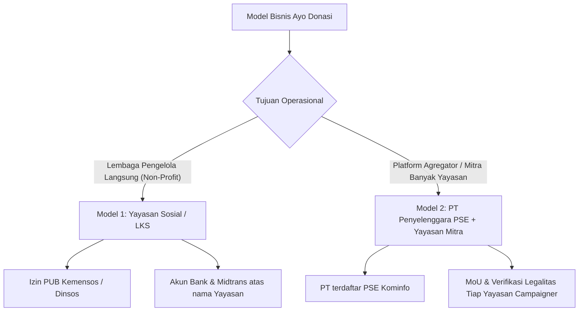
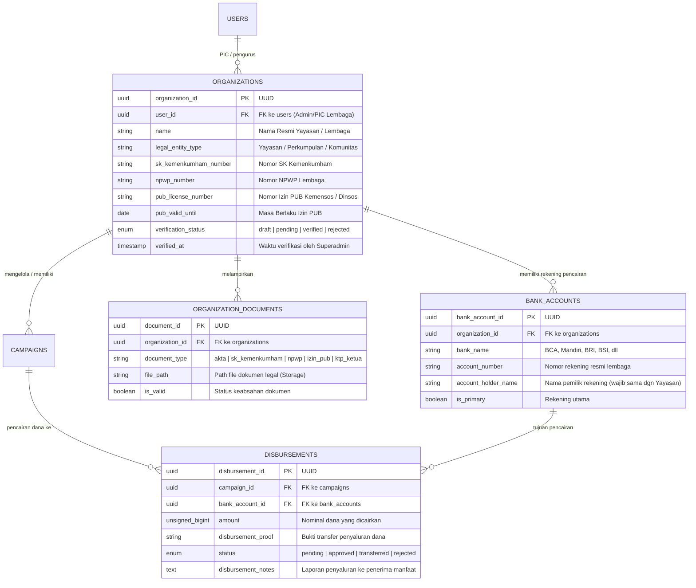

# Rekomendasi Badan Hukum & Rencana Relasi Skema — Ayo Donasi

Dokumen ini berisi panduan pemilihan badan hukum, kepatuhan regulasi di Indonesia, serta rekomendasi desain perancangan struktur tabel/relasi database jika platform **Ayo Donasi** dikembangkan menuju platform produksi nyata (*live production*).

---

## 1. Pilihan Bentuk Badan Hukum & Izin Operasional

Di Indonesia, penggalangan dana publik (*crowdfunding*) diatur secara ketat untuk mencegah penipuan dan pencucian uang. Berikut adalah 2 opsi model kelembagaan:

### Opsi 1: Yayasan Sosial (Non-Profit Langsung) — *Paling Direkomendasikan untuk Awal*
- **Bentuk:** Yayasan yang bergerak di bidang sosial, kemanusiaan, atau keagamaan (UU No. 16/2001 & UU No. 28/2004).
- **Karakteristik:** Yayasan Anda sendiri yang bertindak sebagai pembuat kampanye (*campaign organizer*) dan menyalurkan bantuan langsung kepada penerima manfaat.
- **Izin yang Diperlukan:**
  1. Akta Notaris & SK Kemenkumham Pendirian Yayasan.
  2. NPWP Badan atas nama Yayasan.
  3. Tanda Daftar Lembaga Kesejahteraan Sosial (TDLKS) dari Dinas Sosial.
  4. Izin Pengumpulan Uang dan Barang (PUB) dari Kemensos / Dinsos (Permensos No. 8/2021).
  5. Rekening Giro Bank atas nama Yayasan (untuk aktivasi Midtrans Production).

### Opsi 2: PT Teknologi Finansial / PSE + Multi-Yayasan Mitra (Model Kitabisa)
- **Bentuk:** Perseroan Terbatas (PT) sebagai pengelola platform digital (PSE), bekerja sama dengan berbagai yayasan mitra terverifikasi.
- **Karakteristik:** Setiap yayasan/lembaga terdaftar dapat membuat kampanye setelah diverifikasi legalitasnya.
- **Izin Tambahan:** Tanda Daftar PSE Domestik Kominfo dan perjanjian kerjasama resmi (MoU) dengan yayasan pemegang izin PUB.

---

## 2. Dampak Terhadap Struktur Database & Relasi Skema

Jika bertransformasi menjadi platform berbadan hukum (khususnya model multi-lembaga / verifikasi kepatuhan), aplikasi memerlukan entitas baru untuk mencatat **legalitas organisasi**, **verifikasi identitas penggalang**, dan **rekening penyaluran dana**.

### 2.1. Bagan Relasi Baru (Usulan ERD Skema Legalitas)

---

## 3. Rincian Penyesuaian Tabel yang Ada

### 3.1. Penyesuaian Tabel `campaigns`
Tambahkan kolom relasi organisasi dan transparansi hukum:
- `organization_id` (UUID, FK ke `organizations`, `nullable`): Menunjukkan yayasan mana yang bertanggung jawab secara hukum atas kampanye tersebut.
- `legal_permit_number` (String, `nullable`): Nomor izin spesifik kampanye (jika izin PUB per kegiatan).
- `operational_fee_percentage` (Decimal, default `5.00`): Potongan operasional resmi yang diizinkan undang-undang (Permensos No. 8/2021 membatasi biaya operasional maksimal 10% untuk donasi umum).

### 3.2. Penyesuaian Tabel `users`
- Tambahkan role `superadmin` (pengelola pusat platform yang memvalidasi berkas legalitas yayasan) dan `fundraiser` (perwakilan resmi yayasan).

---

## 4. Checklist Kepatuhan Sebelum Go-Live (Produksi)

| No | Persyaratan Legal / Teknis | Instansi Terkait | Status Kesiapan |
| :-: | :--- | :--- | :---: |
| 1 | Pendirian Akta Notaris Yayasan & SK Menkumham | Notaris & Kemenkumham | Belum Ada |
| 2 | NPWP Badan atas nama Yayasan | Kantor Pelayanan Pajak (KPP) | Belum Ada |
| 3 | Rekening Bank Operasional atas nama Yayasan | Bank Umum (BCA/Mandiri/BRI/BSI) | Belum Ada |
| 4 | Izin Pengumpulan Uang dan Barang (PUB) | Dinsos / Kemensos | Belum Ada |
| 5 | Pendaftaran Penyelenggara Sistem Elektronik (PSE) | Kominfo (oss.go.id) | Belum Ada |
| 6 | Upgrade Akun Midtrans ke **Production Mode** | Midtrans (midtrans.com) | Sandbox |
| 7 | Halaman Syarat & Ketentuan (*Terms of Service*) serta Kebijakan Privasi (*Privacy Policy*) | Internal Platform | Belum Ada |
| 8 | Fitur Transparansi Laporan Penyaluran Dana (*Disbursement/Report*) | Pengembangan Web | Rekomendasi |
