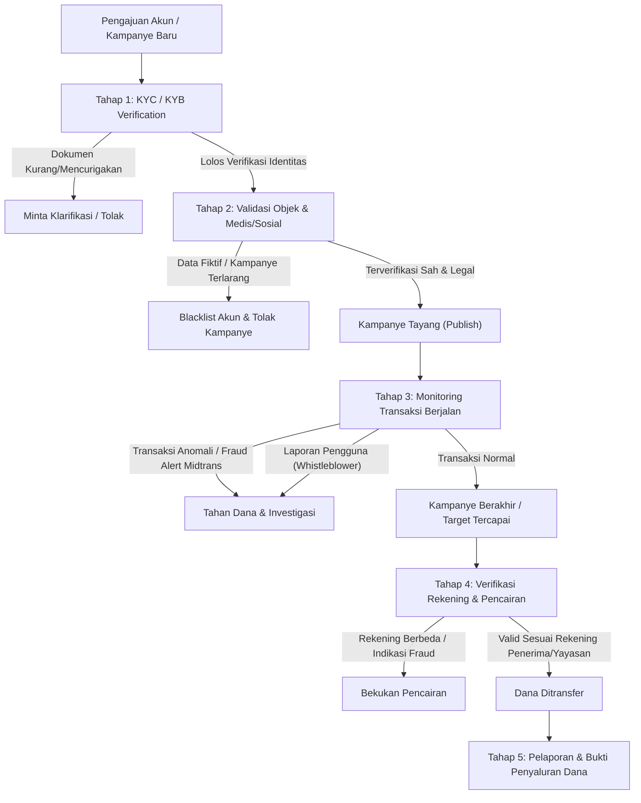

# Standar Operasional Prosedur (SOP) Verifikasi & Mitigasi Fraud — Ayo Donasi

Dokumen ini memuat prosedur standar operasional (SOP) untuk verifikasi identitas penggalang dana, keabsahan kampanye donasi, mitigasi penipuan (*fraud*), pemantauan transaksi mencurigakan, serta tata kelola pencairan dana (*disbursement*) pada platform **Ayo Donasi**.

---

## 1. Tujuan dan Ruang Lingkup

1. **Tujuan**:
   - Mencegah penggunaan platform untuk penggalangan dana palsu, fiktif, atau berbau penipuan.
   - Mencegah tindak pidana pencucian uang (TPPU / *Anti-Money Laundering*) dan pendanaan terorisme.
   - Memastikan dana donatur 100% tersalurkan kepada penerima manfaat yang sah dan terbukti membutuhkan.
   - Mempertahankan kepatuhan terhadap regulasi perizinan PUB (Kemensos) dan standar keamanan payment gateway (Midtrans).

2. **Ruang Lingkup**:
   - Verifikasi penggalang dana (KYC / *Know Your Customer* & KYB / *Know Your Business*).
   - Kurasi dan validasi konten kampanye sebelum dipublikasikan.
   - Pemantauan transaksi dan integrasi pembayaran payment gateway.
   - Prosedur pelaporan masyarakat (*whistleblowing*) dan penanganan sengketa (*chargeback/refund*).
   - Validasi pencairan dana (*disbursement*) dan pelaporan pertanggungjawaban.

---

## 2. Diagram Alur Verifikasi & Pencegahan Fraud

---

## 3. SOP Tahap 1: Verifikasi Identitas (KYC / KYB)

Sebelum kampanye atau penggalang dana diizinkan mengumpulkan dana, wajib melalui proses identifikasi:

### 3.1. Penggalang Dana Perorangan (Individu)
1. **Dokumen Wajib**:
   - Foto e-KTP asli (jelas, tidak buram, masa berlaku seumur hidup).
   - *Selfie* memegang e-KTP dan selembar kertas bertuliskan *"Verifikasi Ayo Donasi - [Tanggal Hari Ini]"*.
   - Kartu Keluarga (KK) jika menggalang dana untuk anggota keluarga inti (anak, orang tua, pasangan).
   - Nomor WhatsApp aktif dan akun media sosial pribadi yang aktif minimal 6 bulan.
2. **Pemeriksaan Petugas Verifikator**:
   - Cek kesesuaian NIK dan nama pada e-KTP.
   - Cek database internal: apakah nama/NIK/nomor HP pernah masuk ke dalam daftar hitam (*blacklist* penipuan).
   - Verifikasi video call singkat (opsional, jika nominal target di atas Rp 20.000.000).

### 3.2. Penggalang Dana Lembaga / Yayasan (Badan Hukum)
1. **Dokumen Wajib**:
   - Akta Pendirian Yayasan & Akta Perubahan Terakhir (dari Notaris).
   - SK Pengesahan dari Kemenkumham RI.
   - NPWP Badan atas nama Yayasan.
   - Surat Izin Operasional / TDLKS dari Dinas Sosial setempat.
   - Surat Izin PUB (Pengumpulan Uang dan Barang) yang masih berlaku.
   - e-KTP Ketua Yayasan / Penanggung Jawab dan Surat Kuasa resmi bermaterai.
2. **Pemeriksaan Petugas**:
   - Cek keabsahan SK Kemenkumham melalui portal resmi Kemenkumham.
   - Pastikan rekening bank yang diajukan mutlak atas nama **Yayasan**, bukan rekening pribadi pengurus.

---

## 4. SOP Tahap 2: Kurasi & Verifikasi Objek Kampanye

Tidak semua permohonan donasi dapat disetujui. Kampanye harus lolos kriteria keabsahan:

### 4.1. Kategori Medis / Kesehatan
- Wajib melampirkan **Surat Keterangan Rawat / Diagnosis Medis Asli** dari Rumah Sakit atau Puskesmas resmi (maksimal 1 bulan terakhir).
- Surat estimasi rincian biaya pengobatan dari pihak medis/administrasi RS.
- Foto pasien terkini yang wajar dan tidak mengeksploitasi secara berlebihan.
- Petugas verifikator berhak menghubungi *call center* RS terkait untuk konfirmasi keabsahan surat medis.

### 4.2. Kategori Pembangunan Sarana / Sosial / Bencana
- Surat rekomendasi dari aparat desa/kelurahan setempat (RT/RW/Kepala Desa).
- Foto kondisi fisik lokasi terkini dan rincian Rancangan Anggaran Biaya (RAB) yang transparan.

### 4.3. Kriteria Konten yang DITOLAK KERAS (Blacklist):
1. Penggalangan dana untuk kepentingan politik praktis, pemilu, atau ormas terlarang.
2. Pembayaran utang pribadi akibat judi online, pinjaman online konsumtif, atau investasi ilegal.
3. Donasi untuk tindakan melanggar hukum, terorisme, radikalisme, atau kekerasan.
4. Kampanye duplikat/plagiasi dari platform lain tanpa persetujuan pihak keluarga korban yang sah.

---

## 5. SOP Tahap 3: Mitigasi Fraud Transaksi & Payment Gateway

Platform menggunakan integrasi payment gateway **Midtrans** dengan sistem perlindungan ganda:

### 5.1. Validasi Keamanan Sistem (Automated Security)
1. **Verifikasi Hash Signature SHA-512**:
   - Setiap webhook notifikasi callback dari Midtrans divalidasi keasliannya menggunakan formula:
     $$\text{Signature} = \text{SHA512}(\text{order\_id} + \text{status\_code} + \text{gross\_amount} + \text{server\_key})$$
   - Permintaan dengan signature palsu langsung ditolak HTTP 403 dan dicatat ke log peringatan (`Log::warning`).
2. **Pencegahan Double-Spending / Replay Attack**:
   - Jika transaksi telah berstatus `completed`, notifikasi non-pembalikan diabaikan agar status final tidak dapat dimanipulasi mundur.
3. **Pencocokan Nominal Ketat**:
   - Nominal yang diterima dari webhook diverifikasi presisi terhadap nilai `gross_amount` di database internal. Selisih nominal menghasilkan HTTP 400.
4. **Rate Limiting**:
   - Endpoint pembuatan transaksi donasi (`POST /donasi/payment`) dibatasi maksimal 10 permintaan per menit (`throttle:10,1`) per IP untuk mencegah *carding* atau *spam flooding*.

### 5.2. Penanganan Status Fraud Detection System (FDS Midtrans)
- Status **`accept`**: Transaksi dinyatakan aman, donasi diverifikasi menjadi `completed`.
- Status **`challenge`**: Transaksi dicurigai anomali kartu kredit/debit; sistem mengunci status pada posisi `pending` hingga di-*review* manual di dashboard Midtrans.
- Status **`deny`**: Ditolak langsung oleh sistem anti-fraud perbankan.

### 5.3. Penanganan Transaksi Pembalikan (Refund & Chargeback)
- Jika bank/pemilik dana asli mengajukan *chargeback* (klaim transaksi tanpa izin):
  1. Sistem otomatis memperbarui status transaksi dan donasi menjadi `failed`.
  2. Nilai `collected_amount` pada kampanye terkait otomatis didekremitasi/dihitung ulang.
  3. Petugas keuangan menahan pencairan dana kampanye hingga sengketa selesai.

---

## 6. SOP Tahap 4: Prosedur Pencairan Dana (Disbursement)

Dana donasi tidak pernah dicairkan otomatis secara instan. Pencairan wajib melalui audit kepatuhan:

| Langkah | Penanggung Jawab | Prosedur |
| :---: | :--- | :--- |
| **1. Pengajuan** | Penggalang Dana | Mengajukan permohonan pencairan dana via dashboard dengan melampirkan rencana alokasi penggunaan dana. |
| **2. Audit Rekening** | Tim Finance | Memastikan rekening tujuan pencairan **100% cocok** dengan identitas terverifikasi (KTP penggalang langsung / rekening RS / rekening resmi Yayasan). Rekening perantara/pihak ketiga dilarang. |
| **3. Konfirmasi** | Tim Verifikator | Menghubungi penggalang/penerima manfaat via telepon/video call untuk memastikan kondisi mutakhir dan kebutuhan dana. |
| **4. Approval** | Superadmin / Direksi | Otorisasi transfer dana ke rekening tujuan via perbankan resmi. |
| **5. Dokumentasi** | Tim Finance | Mengunggah bukti mutasi/transfer bank ke dalam log sistem. |

---

## 7. SOP Tahap 5: Pelaporan & Transparansi Pasca-Penyaluran

1. Penggalang dana wajib mengunggah **Laporan Penyaluran Donasi** dalam waktu maksimal **14 hari kerja** setelah dana dicairkan.
2. Laporan wajib memuat:
   - Bukti kuitansi / nota pembayaran resmi RS / toko bangunan / pihak ketiga.
   - Foto/dokumentasi serah terima bantuan langsung kepada penerima manfaat.
3. **Sanksi Keterlambatan / Manipulasi**:
   - Jika dalam 14 hari tidak ada laporan pertanggungjawaban, akun dibekukan sementara.
   - Jika terbukti melakukan rekayasa kuitansi/anggaran:
     - Akun dan NIK dimasukkan ke dalam daftar hitam permanen (*permanent blacklist*).
     - Menuntut pengembalian dana donasi secara perdata.
     - Melaporkan kasus penipuan kepada Kepolisian RI atas dasar dugaan Pasal 378 KUHP (Penipuan) dan UU ITE.

---

## 8. Layanan Pengaduan Masyarakat (Whistleblowing System)

1. Pada setiap halaman kampanye (`/donasi/detail/{slug}`), disediakan tombol **"Laporkan Kampanye Ini"**.
2. Pengguna/masyarakat dapat melaporkan indikasi fraud dengan melampirkan:
   - Bukti foto/tangkapan layar bahwa pasien sudah sembuh/meninggal namun kampanye tetap berjalan.
   - Bukti foto bahwa data kampanye dicuri dari media sosial orang lain.
3. **SLA Penanganan Laporan**:
   - Tim Support wajib merespons laporan masyarakat maksimal dalam waktu **1 x 24 jam**.
   - Jika indikasi fraud kuat, kampanye langsung di-nonaktifkan sementara (`status = false`) selama proses investigasi.
