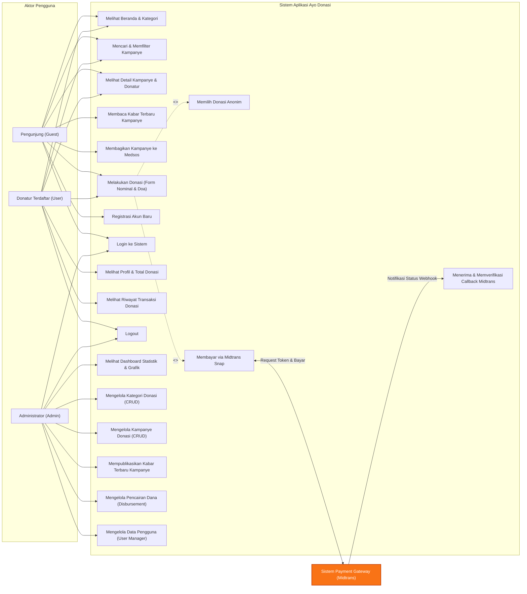

# Use Case Diagram & Spesifikasi Skenario Sistem — Ayo Donasi

Dokumen ini memuat perancangan **Use Case Diagram (UML)**, identifikasi aktor, batasan sistem, dan spesifikasi skenario interaksi use case untuk aplikasi **Ayo Donasi**. Dokumen ini dirancang sebagai acuan bab Analisis & Perancangan Sistem pada Laporan Tugas Akhir / Skripsi.

---

## 1. Identifikasi Aktor (Actor Definition)

Sistem memiliki 4 aktor yang berinteraksi secara langsung maupun tidak langsung:

| No | Aktor | Tipe | Deskripsi Peran & Tanggung Jawab |
| :-: | :--- | :---: | :--- |
| 1 | **Tamu (Guest)** | Manusia | Pengguna umum yang belum melakukan login. Dapat menjelajahi kampanye, mencari donasi, berdonasi secara anonim/guest, serta mendaftar akun. |
| 2 | **Donatur Terdaftar (User)** | Manusia | Pengguna yang telah memiliki akun dan login. Memiliki hak yang sama dengan Tamu ditambah kemampuan memantau total donasi pribadi dan riwayat transaksi. |
| 3 | **Administrator (Admin)** | Manusia | Pengelola sistem dengan hak akses penuh (`role: admin`) ke panel dashboard, manajemen data kategori, kampanye, kabar terbaru, pencairan dana, dan pengguna. |
| 4 | **Payment Gateway (Midtrans)** | Sistem Eksternal | Sistem pembayaran pihak ketiga yang bertugas menerbitkan Snap Token pembayaran serta mengirimkan webhook callback status pembayaran secara asinkron. |

---

## 2. Use Case Diagram (Bagan UML)

---

## 3. Matriks Hak Akses Use Case

| Kode | Nama Use Case | Tamu (Guest) | Donatur (User) | Admin | Sistem Midtrans |
| :---: | :--- | :---: | :---: | :---: | :---: |
| **UC-01** | Melihat Beranda & Daftar Kampanye | V | V | V | - |
| **UC-02** | Mencari & Memfilter Kampanye | V | V | V | - |
| **UC-03** | Melihat Detail Kampanye & Donatur | V | V | V | - |
| **UC-04** | Membaca Kabar Terbaru Kampanye | V | V | V | - |
| **UC-05** | Membagikan Kampanye ke Medsos | V | V | V | - |
| **UC-06** | Melakukan Transaksi Donasi | V | V | - | - |
| **UC-07** | Membayar via Midtrans Snap | V | V | - | V |
| **UC-08** | Verifikasi Callback Status Donasi | - | - | - | V |
| **UC-09** | Registrasi Akun Baru | V | - | - | - |
| **UC-10** | Login ke Akun | V | - | V | - |
| **UC-11** | Melihat Profil & Total Kontribusi | - | V | - | - |
| **UC-12** | Melihat Riwayat Donasi Pribadi | - | V | - | - |
| **UC-13** | Logout | - | V | V | - |
| **UC-14** | Dashboard Statistik Grafik Donasi | - | - | V | - |
| **UC-15** | Manajemen Kategori (CRUD) | - | - | V | - |
| **UC-16** | Manajemen Kampanye (CRUD) | - | - | V | - |
| **UC-17** | Publikasi Kabar Terbaru Kampanye | - | - | V | - |
| **UC-18** | Manajemen Pencairan Dana | - | - | V | - |
| **UC-19** | Manajemen Pengguna (User Manager) | - | - | V | - |

---

## 4. Rincian Skenario Use Case Utama (Use Case Specifications)

Berikut deskripsi formal skenario naratif (*use case narration*) yang umum diminta dalam laporan tugas akhir:

### 4.1. Skenario: Melakukan Donasi (UC-06 & UC-07)
- **Aktor Utama**: Tamu (Guest) atau Donatur Terdaftar (User).
- **Aktor Pendukung**: Sistem Midtrans.
- **Kondisi Awal (Pre-condition)**: Pengguna berada di halaman detail kampanye (`/donasi/detail/{slug}`) yang masih berstatus aktif dan belum melewati batas tanggal akhir.
- **Kondisi Akhir (Post-condition)**: Record `donations` dan `transactions` terbuat dengan status `pending`, popup Midtrans Snap muncul dan donatur mendapatkan instruksi pembayaran.
- **Alur Utama (Main Flow)**:
  1. Pengguna menekan tombol **"Donasikan"**.
  2. Sistem menampilkan modal input donasi (`components/modal-payment.blade.php`).
  3. Pengguna mengisi nominal donasi (minimal Rp 1.000), pesan doa (opsional), dan memilih opsi tampilkan nama atau anonim.
  4. Pengguna menekan tombol **"Lanjutkan"**.
  5. Sistem memvalidasi ketersediaan dan status aktif kampanye.
  6. Sistem menyimpan data ke tabel `donations` dan membuat transaksi baru di tabel `transactions` dengan order ID `ORD-{UUID}`.
  7. Sistem merequest `Snap Token` ke API Midtrans.
  8. Sistem menyimpan Snap Token dan mengarahkan pengguna ke rute pembayaran `/donasi/payment/{id}`.
  9. Pengguna menekan tombol **"Kirim Donasi"**.
  10. Sistem membuka popup Midtrans Snap dan pengguna menyelesaikan pembayaran.
- **Alur Alternatif (Alternative Flow)**:
  - *5a. Kampanye sudah nonaktif / tanggal kedaluwarsa*: Sistem membatalkan proses dan mengembalikan pengguna dengan pesan error *"Kampanye ini sudah tidak menerima donasi"*.
  - *5b. Nominal kurang dari Rp 1.000*: Sistem menampilkan pesan validasi error pada form input.

---

### 4.2. Skenario: Verifikasi Callback Pembayaran (UC-08)
- **Aktor Utama**: Sistem Midtrans (External Server).
- **Kondisi Awal**: Donatur telah membayar tagihan via channel Midtrans (QRIS, VA, dsb).
- **Kondisi Akhir**: Transaksi dan donasi terupdate menjadi `completed`, serta total dana terkumpul kampanye (`collected_amount`) bertambah otomatis.
- **Alur Utama**:
  1. Midtrans mengirimkan HTTP POST request ke `/donasi/payment/callback`.
  2. Sistem memverifikasi keaslian signature hash `SHA-512`.
  3. Sistem mencocokkan `order_id` dan nominal `gross_amount` dengan data transaksi internal.
  4. Jika status notifikasi adalah `settlement` atau `capture` (fraud status: accept):
     - Sistem mengubah status transaksi dan donasi menjadi `completed`.
     - Sistem menghitung ulang akumulasi total donasi completed dan mengupdate kolom `collected_amount` pada kampanye terkait.
  5. Sistem merespons Midtrans dengan HTTP 200 JSON `{"message": "Callback received successfully"}`.
- **Alur Alternatif**:
  - *2a. Signature key tidak valid*: Sistem menolak request (HTTP 403) dan mencatat log keamanan `Log::warning`.
  - *3a. Nominal notifikasi tidak cocok*: Sistem menolak request (HTTP 400).
  - *4a. Status notifikasi cancel/expire/deny*: Sistem mengubah status transaksi dan donasi menjadi `failed`.

---

### 4.3. Skenario: Manajemen Pencairan Dana (UC-18)
- **Aktor Utama**: Administrator.
- **Kondisi Awal**: Admin login dan kampanye memiliki saldo tersedia (`available_balance > 0`).
- **Kondisi Akhir**: Catatan pencairan dana tersimpan di tabel `disbursements`, sisa saldo kampanye berkurang, dan bukti transfer tersimpan di storage.
- **Alur Utama**:
  1. Admin membuka menu **"Pencairan Dana"** (`/admin/disbursements`) dan menekan **"Catat Pencairan Baru"**.
  2. Admin memilih kampanye donasi yang akan dicairkan.
  3. Sistem menampilkan info saldo terkumpul, total yang sudah dicairkan, dan sisa saldo tersedia secara real-time.
  4. Admin menginput nominal penarikan, nama bank, nomor rekening, nama penerima, keperluan penyaluran, serta mengunggah bukti resi transfer.
  5. Admin menekan tombol **"Simpan Pencairan"**.
  6. Sistem memvalidasi bahwa nominal pencairan tidak melebihi sisa saldo tersedia.
  7. Sistem menyimpan data ke tabel `disbursements` dan menyimpan file bukti transfer ke direktori storage publik.
  8. Sistem menampilkan pesan sukses dan mengarahkan kembali ke daftar pencairan.
- **Alur Alternatif**:
  - *6a. Nominal pencairan melebihi sisa saldo*: Sistem menolak pengajuan dan menampilkan pesan error bahwa nominal melebihi sisa saldo kampanye.
