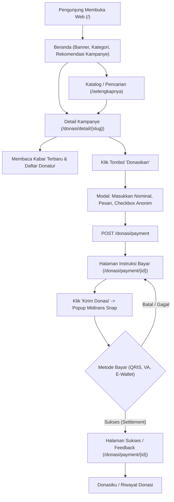

# Spesifikasi Wireframe, Arsitektur UI/UX & Desain Sistem — Ayo Donasi

Dokumen ini berisi cetak biru (*blueprint*) desain antarmuka, tata letak tata ruang (*wireframe layout*), hierarki informasi, prinsip *User Experience* (UX), dan panduan sistem desain visual untuk aplikasi **Ayo Donasi**. Dokumen ini dirancang sebagai acuan pembuatan prototipe di Figma maupun lampiran Bab Perancangan Antarmuka pada Laporan Tugas Akhir / Skripsi.

---

## 1. Prinsip Desain & User Experience (UX)

Dalam perancangan platform donasi digital, aspek kepercayaan (*trust*), kemudahan transaksi (*frictionless*), dan kejelasan informasi (*transparency*) adalah pilar utama:

1. **Frictionless Giving (Donasi Cepat & Fleksibel)**:
   - Donatur tidak diwajibkan login untuk berdonasi (mendukung mode *Guest Checkout*).
   - Opsi anonim (*checkbox*: "Sembunyikan nama saya") tersedia langsung di form nominal.
2. **Visual Hierarchy & Transparansi**:
   - Angka dana terkumpul, target, persentase progres, dan sisa hari kampanye ditempatkan di posisi paling mencolok (*Above the fold*).
   - Seksi "Kabar Terbaru" dan "Daftar Donatur" diletakkan berdampingan untuk membuktikan keaktifan kampanye.
3. **Mobile-First & Responsif**:
   - Mayoritas donatur mengakses melalui smartphone; tombol aksi utama (*Call to Action* "Donasikan Sekarang") dirancang besar, mudah dijangkau ibu jari, dan memiliki posisi sticky/modal responsif.

---

## 2. Design System & Token Visual

| Elemen Desain | Token / Nilai | Implementasi di Proyek | Keterangan |
| :--- | :--- | :--- | :--- |
| **Primary Color** | `#2D527C` / Sky Blue `#0284c7` | `.bg-primaryy`, `.text-primary` | Memberi kesan tenang, amanah, dan terpercaya |
| **Secondary Color** | `#0f172a` (Slate-900) / `#38bdf8` | Tailwind `slate`, `sky` | Kontras teks dan elemen pendukung |
| **Success Color** | `#16a34a` (Green-600) | Badge completed, progress bar | Simbol target tercapai & transaksi sukses |
| **Danger Color** | `#dc2626` (Red-600) | Alert error, badge failed | Penolakan atau batas kedaluwarsa |
| **Background** | `#f8fafc` (Slate-50) | `bg-slate-50`, `bg-slate-100` | Latar belakang bersih dan tidak melelahkan mata |
| **Typography** | Sans-Serif (Figtree / Inter / Arial) | Tailwind font stack | Sangat mudah dibaca di berbagai resolusi layar |
| **Border Radius** | `rounded-2xl` & `rounded-3xl` | Pill-shaped buttons & cards | Memberi kesan ramah (*friendly*) dan modern |

---

## 3. User Flow (Alur Interaksi Pengguna)



---

## 4. Cetak Biru Wireframe Halaman Utama (Low-Fidelity Layouts)

### 4.1. Halaman Beranda Publik (`index.blade.php`)
```text
+--------------------------------------------------------------------------+
|  [Logo AyoDonasi]        [Pencarian...]         (Katalog)   [Login/User] |
+--------------------------------------------------------------------------+
|                                                                          |
|  +--------------------------------------------------------------------+  |
|  |           HERO BANNER / CAROUSEL DOKUMENTASI & PROMO               |  |
|  +--------------------------------------------------------------------+  |
|                                                                          |
|  [KATEGORI DONASI]                                                       |
|  +--------------+  +--------------+  +--------------+  +--------------+  |
|  | [Icon] Medis |  | [Icon] Bencana|  | [Icon] Sosial|  | [Icon] Zakat |  |
|  +--------------+  +--------------+  +--------------+  +--------------+  |
|                                                                          |
|  [PENGGALANGAN DANA TERBARU]                       [Lihat Semua Donasi >]|
|  +-----------------------+ +-----------------------+ +-----------------+ |
|  | [Gambar Kampanye]     | | [Gambar Kampanye]     | | [Gambar]        | |
|  | Judul Kampanye        | | Judul Kampanye        | | ...             | |
|  | [======== 75% ======] | | [==== 40% ==========] | |                 | |
|  | Rp 7.500.000 terkumpul| | Rp 4.000.000 terkumpul| |                 | |
|  | 35 Donatur - 12 Hari  | | 18 Donatur - 5 Hari   | |                 | |
|  +-----------------------+ +-----------------------+ +-----------------+ |
|                                                                          |
|  +--------------------------------------------------------------------+  |
|  |       BANNER AJAKAN: "Ayo Berbagi Kebaikan Bersama AyoDonasi!"     |  |
|  |                    [ Tombol: Lihat Semua Donasi ]                  |  |
|  +--------------------------------------------------------------------+  |
|                                                                          |
|  FOOTER: Kontak | Legalitas | Media Sosial | Copyright                   |
+--------------------------------------------------------------------------+
```

---

### 4.2. Halaman Detail Kampanye (`DetailDonasi.blade.php`)
```text
+--------------------------------------------------------------------------+
|  < Kembali ke Katalog                                                    |
|                                                                          |
|  [KOLOM KIRI - 65%]                     [KOLOM KANAN (STICKY CARD) - 35%]|
|  +------------------------------------+ +------------------------------+ |
|  | FOTO UTAMA KAMPANYE                | | Rincian Penggalangan Dana    | |
|  +------------------------------------+ |                              | |
|  | Judul Kampanye Lengkap             | | Rp 15.450.000 Terkumpul      | |
|  | Tanggal dibuat: 15 Nov 2026        | | [======== 65% =============] | |
|  |                                    | | Target: Rp 25.000.000        | |
|  | DESKRIPSI LENGKAP:                 | | Sisa Waktu: 14 Hari Lagi     | |
|  | Cerita latar belakang, diagnosa    | | Total: 142 Donatur           | |
|  | medis, rincian estimasi biaya...   | |                              | |
|  |                                    | | [   DONASIKAN SEKARANG   ]   | |
|  | KABAR TERBARU (UPDATES):           | | [      BAGIKAN KAMPANYE  ]   | |
|  | [18 Nov] Operasi Tahap 1 Sukses    | |                              | |
|  | [Foto Bukti] Kondisi pasien membaik| | Donatur Teratas:             | |
|  |                                    | | - Budi S. (Rp 100.000)       | |
|  | DAFTAR DOA & DONATUR TERBARU:      | | - Anonim  (Rp 500.000)       | |
|  | - Siti (Rp 50.000) "Cepat sembuh ya"| +------------------------------+ |
|  | - Anonim (Rp 25.000) "Bismillah"   |                                  |
|  | [Pagination: < 1 2 3 >]            |                                  |
|  +------------------------------------+                                  |
+--------------------------------------------------------------------------+
```

---

### 4.3. Modal Input Donasi (`modal-payment.blade.php`)
```text
+----------------------------------------------------+
| [X] Silakan Masukkan Nominal Donasi                |
+----------------------------------------------------+
|                                                    |
| Nominal Donasi (Rp):                               |
| [ Rp 50.000                                      ] |
| *Minimal donasi Rp 1.000                           |
|                                                    |
| Pesan atau Doa (Opsional):                         |
| [ Semoga lekas sembuh dan diangkat penyakitnya... ]|
|                                                    |
| [X] Tampilkan nama saya di daftar donatur          |
|     (Hapus centang untuk donasi sebagai Anonim)    |
|                                                    |
|                               [ Lanjutkan Pembayaran > ]|
+----------------------------------------------------+
```

---

### 4.4. Halaman Pembayaran Midtrans Snap (`DetailPayment.blade.php`)
```text
+----------------------------------------------------+
|               RINGKASAN PEMBAYARAN                 |
+----------------------------------------------------+
| Kampanye       : Bantuan Medis Ananda Budi         |
| Atas Nama      : Bagus Budi Satoto                 |
| Nominal Donasi : Rp 50.000                         |
| Status Bayar   : PENDING                           |
|                                                    |
|    [   KIRIM DONASI (Buka Popup Midtrans)   ]      |
|                                                    |
| (Mendukung: QRIS Gopay, BCA/Mandiri/BRI VA, dsb)   |
+----------------------------------------------------+
```

---

### 4.5. Panel Admin — Dashboard & Manajemen Pencairan (`admin/disbursement`)
```text
+--------------------------------------------------------------------------+
| [Logo] AyoDonasi Admin Panel                     [ Profil Admin | Logout]|
+--------------------------------------------------------------------------+
| (Sidebar)         |  DAFTAR PENCAIRAN DANA (DISBURSEMENTS)               |
| - Dashboard       |  [ + Catat Pencairan Baru ]                          |
| - Kategori        |                                                      |
| - Campaign Donasi |  Filter: [Semua Kampanye v]   Search: [            ] |
| - Pencairan Dana  |                                                      |
| - User Manager    |  +-------------------------------------------------+ |
|                   |  | No | Tgl      | Kampanye | Nominal  | Penerima  | |
|                   |  |----+----------+----------+----------+-----------| |
|                   |  | 1  | 20/11/26 | RS Budi  | 5.000.000| RS Sardjito| |
|                   |  | 2  | 18/11/26 | Bencana  | 2.500.000| Posko PMI | |
|                   |  +-------------------------------------------------+ |
+--------------------------------------------------------------------------+
```

---

## 5. Rekomendasi Implementasi Desain ke Figma

Jika Anda ingin menggambar prototipe ini ke Figma:
1. **Frame Canvas**:
   - Desktop: `Desktop 1440 x 1024`
   - Mobile: `iPhone 14 / Android Large (390 x 844)`
2. **Komponen Reusable (Figma Components)**:
   - `Card-Campaign` (foto, judul, progress bar, nominal).
   - `Navbar-Public` & `Sidebar-Admin`.
   - `Modal-Donation` & `Button-Primary`.
3. **Interaksi Prototipe (Figma Prototype Interaction)**:
   - Hubungkan tombol **"Donasikan"** $\rightarrow$ *Open Overlay* ke **Modal-Donation**.
   - Tombol **"Lanjutkan Pembayaran"** $\rightarrow$ *Navigate to* **DetailPayment Screen**.
   - Tombol **"Kirim Donasi"** $\rightarrow$ Tampilkan simulasi popup Midtrans.
